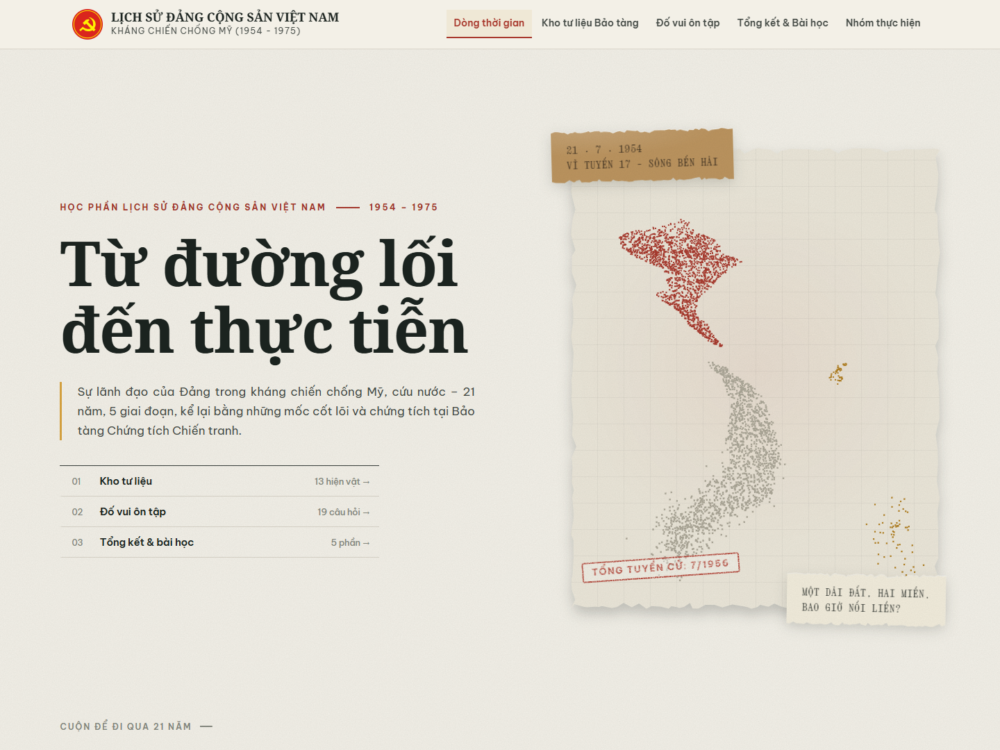

# Lịch sử Đảng 1954–1975 | Từ đường lối đến thực tiễn

Học liệu web tương tác về lịch sử kháng chiến chống Mỹ, cứu nước (1954–1975), kết nối sự kiện lịch sử với tư liệu bảo tàng.

[](https://nhom03-lsd-23c02.vercel.app/)
[](LICENSE)


**Nhóm 03 · Lớp 23C02** · Học phần Lịch sử Đảng Cộng sản Việt Nam, Trường Đại học Khoa học Tự nhiên, ĐHQG-HCM · GVHD ThS. Trần Thị Châu

[Mở website](https://nhom03-lsd-23c02.vercel.app/) · [Báo cáo PDF](docs/bao-cao/bao-cao-nhom-3.pdf)



## Tổng quan

Dự án dành cho sinh viên ôn tập học phần và lập trình viên muốn cập nhật học liệu. Website là một trang tĩnh. Trình duyệt đọc HTML và CSS, sau đó JavaScript nạp dữ liệu từ các tệp cục bộ và chuyển giữa các mục trong cùng trang.

## Tính năng chính

- **Dòng thời gian** gồm 37 mốc trong 5 giai đoạn, có bộ lọc mốc trọng tâm, chi tiết sự kiện và bản đồ minh họa.
- **Kho tư liệu bảo tàng** gồm 13 mục có ảnh, chú thích nguồn và liên kết đến các mốc liên quan.
- **Đố vui ôn tập** gồm 19 câu trắc nghiệm, có giải thích sau mỗi câu và điểm cuối bài.
- **Tổng kết và bài học** hệ thống hóa vai trò lãnh đạo, nguyên nhân thắng lợi, ý nghĩa lịch sử và bài học kinh nghiệm.
- **Nhóm thực hiện** giới thiệu thành viên, phần đóng góp và cảm nghĩ tập thể.

## Yêu cầu hệ thống

- Trình duyệt hiện đại có bật JavaScript để sử dụng website.
- Git nếu lấy mã nguồn bằng lệnh clone.
- Python 3.7 trở lên nếu chạy lệnh máy chủ HTTP bên dưới. Có thể dùng Live Server trong VS Code.
- XeLaTeX và `latexmk` nếu biên dịch báo cáo. Xem yêu cầu về font và lệnh biên dịch trong [hướng dẫn LaTeX](docs/report/README.md).

## Cài đặt và chạy dự án

1. Clone repo và vào thư mục dự án.

   ```bash
   git clone https://github.com/fgogudako/lsd-web.git
   cd lsd-web
   ```

2. Mở [`src/index.html`](src/index.html) trong trình duyệt hoặc chạy máy chủ HTTP từ thư mục gốc.

   ```bash
   python -m http.server 8000 --bind 127.0.0.1 --directory src
   ```

3. Nếu dùng máy chủ HTTP, mở [http://127.0.0.1:8000/](http://127.0.0.1:8000/). Nhấn **Ctrl+C** trong terminal để dừng máy chủ.

Website chạy trực tiếp từ `src/` và không cần cài thư viện, tạo tệp `.env`, chạy build hay dùng Docker.

## Hướng dẫn sử dụng

Ví dụ ôn tập giai đoạn **1961–1965**:

```text
Dòng thời gian → Giai đoạn 1961–1965 → Chiến thắng Ấp Bắc
Kho tư liệu     → Mở thẻ hiện vật → Xem mô tả và nguồn ảnh
Đố vui ôn tập   → Chọn đáp án → Đọc giải thích → Xem tổng điểm
```

Dùng phím **←** và **→** trong **Dòng thời gian** để chuyển giữa các mốc.

## Cấu trúc thư mục

```text
lsd-web/
├── src/
│   ├── index.html                 # Điểm vào của website
│   └── assets/
│       ├── css/                   # Giao diện dùng chung và CSS theo từng mục
│       ├── js/                    # Dữ liệu, điều hướng và logic tương tác
│       └── images/
│           ├── artifacts/         # Ảnh hiện vật
│           └── team/              # Ảnh thành viên và ảnh nhóm
├── docs/
│   ├── giai-doan-*/               # Tư liệu nghiên cứu của 5 giai đoạn
│   ├── tong-ket-va-on-tap/        # Bài tổng kết và ngân hàng câu hỏi JSON
│   ├── bao-cao/                   # Báo cáo PDF và bản Markdown
│   └── report/                    # Mã LaTeX và ảnh minh họa báo cáo
└── LICENSE                        # Giấy phép MIT
```

| Nội dung cần sửa | Tệp liên quan |
| --- | --- |
| Mốc lịch sử và địa điểm | [timeline-data.js](src/assets/js/timeline-data.js), [timeline.js](src/assets/js/timeline.js) |
| Kho tư liệu, tổng kết và thành viên | [data.js](src/assets/js/data.js) |
| Câu hỏi và lời giải | [Ngân hàng JSON](docs/tong-ket-va-on-tap/cau-hoi-quiz.json), [quiz-data.js](src/assets/js/quiz-data.js) |
| Thanh điều hướng và khởi tạo trang | [main.js](src/assets/js/main.js) |
| Nội dung báo cáo | [Bản Markdown](docs/bao-cao/bao-cao-hoan-chinh.md), [mã nguồn LaTeX](docs/report/) |

## Đóng góp

1. Tạo nhánh từ nhánh đích của Pull Request. Ví dụ khi nhánh đích là `main`:

   ```bash
   git switch main
   git pull --ff-only
   git switch -c docs/cap-nhat-hoc-lieu
   ```

2. Khi sửa tư liệu hoặc câu hỏi, cập nhật cả bản trong `docs/` và dữ liệu tương ứng trong `src/`. Mở website và kiểm tra luồng vừa thay đổi trên màn hình máy tính và điện thoại.
3. Commit, đẩy nhánh lên GitHub và [mở Pull Request](https://github.com/fgogudako/lsd-web/compare). Ghi rõ nội dung thay đổi, cách kiểm tra và kèm ảnh nếu sửa giao diện.

## Contributors

<table>
  <tr>
    <td align="center" valign="top">
      <a href="https://github.com/Schooleo"></a><br />
      <a href="https://github.com/Schooleo"><b>Lê Nguyễn Nhật Trường</b></a><br />
      <sub>23127136</sub><br />
      <sub>Nhóm trưởng</sub>
    </td>
    <td align="center" valign="top">
      <a href="https://github.com/PaoPao1406"></a><br />
      <a href="https://github.com/PaoPao1406"><b>Đoàn Lê Gia Bảo</b></a><br />
      <sub>23127025</sub><br />
      <sub>Nội dung giai đoạn 1</sub>
    </td>
    <td align="center" valign="top">
      <a href="https://github.com/KhaiPhong25"></a><br />
      <a href="https://github.com/KhaiPhong25"><b>Vương Khải Phong</b></a><br />
      <sub>23127453</sub><br />
      <sub>Nội dung giai đoạn 2</sub>
    </td>
    <td align="center" valign="top">
      <a href="https://github.com/NguyenAn05"></a><br />
      <a href="https://github.com/NguyenAn05"><b>Nguyễn Văn An</b></a><br />
      <sub>23127317</sub><br />
      <sub>Nội dung giai đoạn 3</sub>
    </td>
    <td align="center" valign="top">
      <a href="https://github.com/KwanTheAsian"></a><br />
      <a href="https://github.com/KwanTheAsian"><b>Biện Xuân An</b></a><br />
      <sub>23127020</sub><br />
      <sub>Nội dung giai đoạn 4</sub>
    </td>
  </tr>
  <tr>
    <td align="center" valign="top">
      <a href="https://github.com/mqt4n"></a><br />
      <a href="https://github.com/mqt4n"><b>Mạch Quốc Tấn</b></a><br />
      <sub>23127115</sub><br />
      <sub>Nội dung giai đoạn 5</sub>
    </td>
    <td align="center" valign="top">
      <a href="https://github.com/fgogudako"></a><br />
      <a href="https://github.com/fgogudako"><b>Lê Hữu Minh Quang</b></a><br />
      <sub>23127108</sub><br />
      <sub>Tổng kết và hiệu đính</sub>
    </td>
    <td align="center" valign="top">
      <a href="https://github.com/Simpolette"></a><br />
      <a href="https://github.com/Simpolette"><b>Hoàng Minh Giang</b></a><br />
      <sub>23127043</sub><br />
      <sub>Giao diện và dòng thời gian</sub>
    </td>
    <td align="center" valign="top">
      <a href="https://github.com/VNQuy94"></a><br />
      <a href="https://github.com/VNQuy94"><b>Văn Ngọc Quý</b></a><br />
      <sub>23127114</sub><br />
      <sub>Kho tư liệu</sub>
    </td>
    <td align="center" valign="top">
      <a href="https://github.com/CrossManger"></a><br />
      <a href="https://github.com/CrossManger"><b>Vũ Hoàng Minh</b></a><br />
      <sub>23127427</sub><br />
      <sub>Đố vui và trang nhóm</sub>
    </td>
  </tr>
</table>

## Giấy phép

Mã nguồn website do Nhóm 03 phát triển được phát hành theo [giấy phép MIT](LICENSE). Khi sử dụng lại ảnh hoặc tư liệu của bên thứ ba, hãy xem nguồn và điều kiện sử dụng của từng tư liệu.
