# PHẦN 4 GIỚI THIỆU SẢN PHẨM HỌC LIỆU SỐ

## 1 Kết quả xây dựng và triển khai website

Trên cơ sở nội dung nghiên cứu ở phần 2 và những nhận định tổng kết ở phần 3, nhóm đã xây dựng website học liệu “Từ đường lối đến thực tiễn”, phục vụ tìm hiểu sự lãnh đạo của Đảng trong kháng chiến chống Mỹ, cứu nước giai đoạn 1954 - 1975. Website được triển khai trên Vercel và có thể truy cập tại [https://nhom03-lsd-23c02.vercel.app/](https://nhom03-lsd-23c02.vercel.app/). Người học sử dụng trực tiếp bằng trình duyệt, không cần cài đặt ứng dụng hay đăng nhập. [3]

Sản phẩm kết nối ba hoạt động học tập: theo dõi tiến trình lịch sử, tìm hiểu chứng tích và tự kiểm tra kiến thức. Thanh điều hướng gồm năm khu vực: **Dòng thời gian**, **Kho tư liệu Bảo tàng**, **Đố vui ôn tập**, **Tổng kết & Bài học** và **Nhóm thực hiện**. Cách tổ chức này chuyển phần nghiên cứu thành các nội dung có thể lựa chọn và tương tác, thay vì chỉ trình bày dưới dạng văn bản liên tục.

| Thành phần | Kết quả trên website đã triển khai |
| --- | --- |
| Nội dung theo tiến trình | 5 giai đoạn từ năm 1954 đến năm 1975 |
| Kho tư liệu Bảo tàng | 13 mục tư liệu, phân bố theo các giai đoạn lần lượt là 2, 2, 2, 2 và 5 mục |
| Ôn tập trắc nghiệm | 19 câu hỏi, mỗi câu có 4 lựa chọn và phần giải thích |
| Tổng kết | Vai trò lãnh đạo của Đảng, 4 nguyên nhân thắng lợi, ý nghĩa lịch sử và 5 bài học kinh nghiệm |
| Giới thiệu nhóm | 10 thành viên, kèm thông tin và nhiệm vụ thực hiện |

Các số lượng trên được ghi nhận từ phiên bản website đang hoạt động ngày 23/11/2026. Những ảnh trong phần này được chụp trực tiếp bằng trình duyệt Microsoft Edge từ địa chỉ đã triển khai, không phải bản thiết kế hoặc ảnh dựng giao diện.

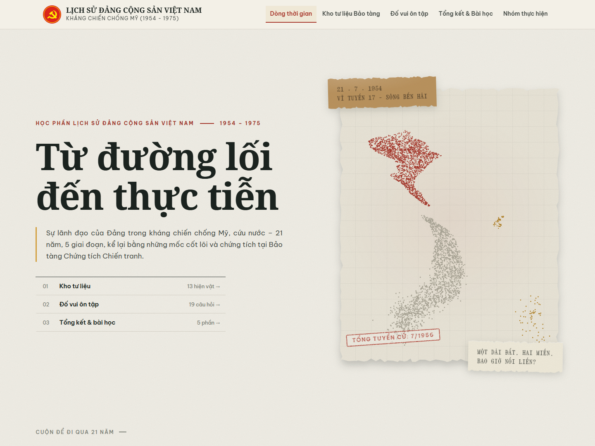

*Hình 4.1. Trang mở đầu với sơ đồ minh họa Việt Nam và các liên kết nhanh tới kho tư liệu, ôn tập, tổng kết. Nguồn: website của nhóm, chụp ngày 23/11/2026.*

## 2 Kiến trúc và công nghệ sử dụng

Website được tổ chức theo kiến trúc giao diện tĩnh, sử dụng **HTML5, CSS3 và JavaScript thuần**. HTML tạo cấu trúc nội dung; CSS quy định bố cục, màu sắc, kiểu chữ và cách hiển thị trên các kích thước màn hình; JavaScript xử lý điều hướng, dựng nội dung từ dữ liệu, mở hộp chi tiết, dựng và duyệt kho tư liệu, chấm điểm trắc nghiệm. Các khu vực dùng chung một trang HTML và chuyển đổi bằng thao tác điều hướng, không cần tải lại toàn bộ trang cho từng chức năng.

Mã JavaScript của bản triển khai được chia theo trách nhiệm. Tệp `data.js` chứa dữ liệu tư liệu bảo tàng, tổng kết và nhóm; `quiz-data.js` chứa câu hỏi ôn tập; nội dung dòng thời gian được cung cấp bởi `timeline-data.js` thông qua `TL_DATA`; `timeline.js`, `gallery.js`, `summary.js` và `quiz.js` xử lý các khu vực tương ứng; `main.js` điều phối điều hướng và thông tin nhóm. Tệp `land3d.js` tạo hiệu ứng sơ đồ Việt Nam bằng hệ thống điểm hạt trên Canvas 2D, gợi cảm giác chiều sâu và chuyển động. Đây là sơ đồ minh họa cho trải nghiệm học tập, không phải bản đồ địa lý dùng để đo đạc. Các tệp được nạp bằng thẻ `script` thông thường; việc chia chức năng không đồng nghĩa với sử dụng chuẩn ES module.

Việc tách dữ liệu khỏi phần xử lý giúp nhóm có thể hiệu đính nội dung, bổ sung hình ảnh hoặc điều chỉnh câu hỏi mà không phải viết lại toàn bộ giao diện. Website hiện xử lý hoạt động học tập ở phía trình duyệt; chưa có hệ thống tài khoản, cơ sở dữ liệu phía máy chủ hay cơ chế lưu kết quả cá nhân lâu dài. Phạm vi này phù hợp với một sản phẩm học liệu trong học phần, tập trung vào truy cập, đọc và ôn tập.

## 3 Các chức năng đã hoàn thành

### 3.1 Dòng thời gian tương tác theo năm giai đoạn

Khu vực Dòng thời gian là trục chính của website. Phiên bản đã triển khai trình bày nội dung theo hình thức **cuộn kể chuyện kết hợp các khối kiến thức**, thay cho việc chỉ chuyển từng slide riêng biệt. Năm giai đoạn được nối tiếp từ 1954 - 1960 đến 1973 - 1975; mỗi giai đoạn làm rõ bối cảnh, đường lối, kết quả thực tiễn, chứng tích liên quan và nội dung ghi nhớ.

Trên màn hình máy tính, bảng thông tin bên cạnh nội dung hiển thị thời điểm, tên giai đoạn và sơ đồ minh họa. Thước thời gian cho phép chọn nhanh giai đoạn; các ký hiệu phân biệt **bối cảnh**, **đường lối** và **thực tiễn** giúp người đọc nhận ra vai trò của từng mốc. Khi cuộn trang, thông tin đang được theo dõi được cập nhật, hỗ trợ định vị sự kiện trong tiến trình chung. Người dùng cũng có thể chuyển mốc bằng phím mũi tên trái, phải.

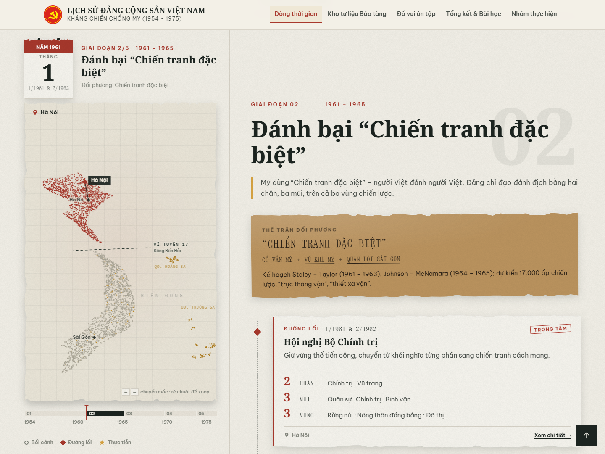

*Hình 4.2. Giai đoạn 1961 - 1965 với bảng thông tin, sơ đồ minh họa và thước thời gian. Nguồn: website của nhóm, chụp ngày 23/11/2026.*

Một số mốc trọng tâm có nút **Xem chi tiết**, mở hộp nội dung bổ sung mà không rời khỏi mạch đọc. Chẳng hạn, người học có thể mở phần Chiến thắng Ấp Bắc để tìm hiểu thêm ý nghĩa thực tiễn của sự kiện. Cách trình bày theo lớp giúp giữ phần tổng quan ngắn gọn, đồng thời dành chỗ cho việc tìm hiểu sâu khi cần.

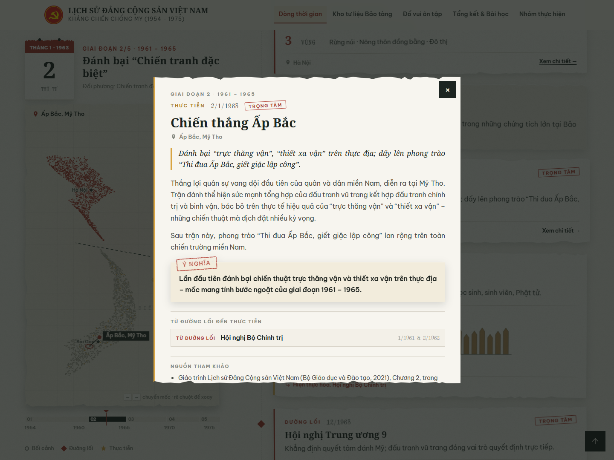

*Hình 4.3. Hộp chi tiết sự kiện được mở từ dòng thời gian. Nguồn: website của nhóm, chụp ngày 23/11/2026.*

### 3.2 Kho tư liệu Bảo tàng

Kho tư liệu tập hợp 13 mục minh họa gắn với năm giai đoạn nghiên cứu. Các thẻ có hình ảnh, tên tư liệu, nhãn giai đoạn và phần giới thiệu ngắn, được trình bày trên cùng một kho để người học duyệt nội dung. Thẻ trực thăng UH-1 Huey được làm nổi bật trên một hàng riêng, kết hợp ảnh lớn với phần thuyết minh và nút liên kết tới dòng thời gian. Cách bố trí này giúp liên hệ hiện vật với bối cảnh và nội dung học liệu mà không cần rời khỏi website.

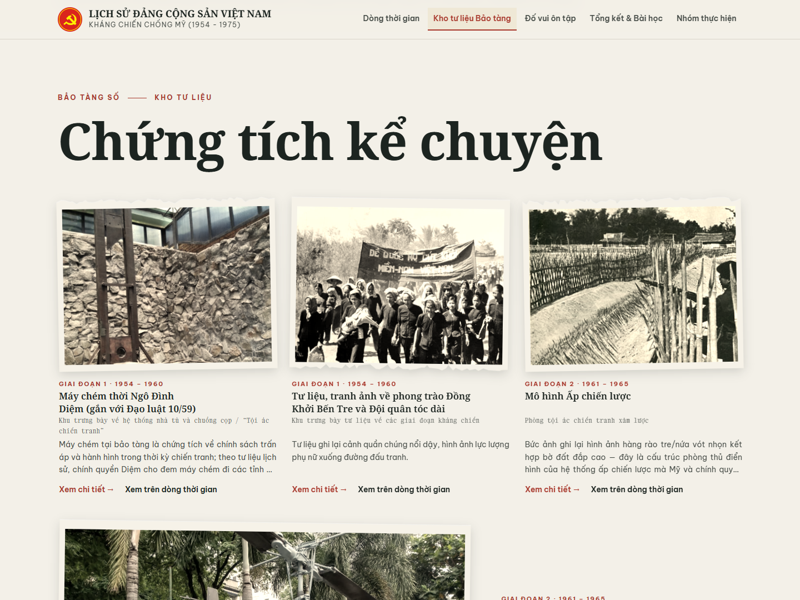

*Hình 4.4. Giao diện kho tư liệu Bảo tàng. Nguồn: website của nhóm, chụp ngày 23/11/2026.*

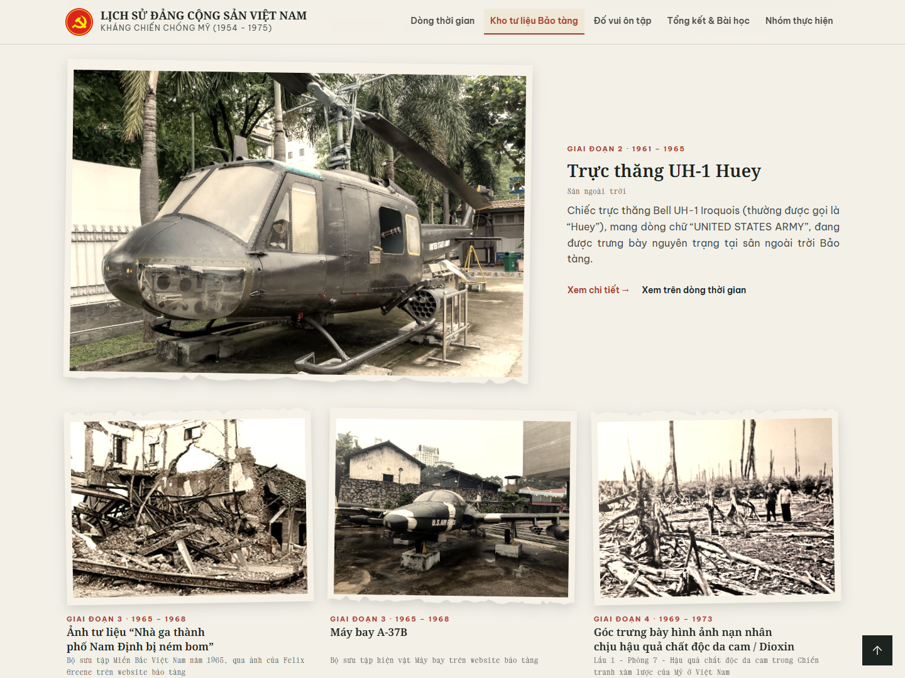

*Hình 4.5. Thẻ trực thăng UH-1 Huey nổi bật và liên kết tới dòng thời gian. Nguồn: website của nhóm, chụp ngày 23/11/2026.*

Nút **Xem chi tiết** mở ảnh lớn cùng thông tin về vị trí hoặc bộ sưu tập, nội dung thuyết minh và nhãn nguồn ảnh. Hộp chi tiết có điều hướng giữa các mục và nút **Xem trên dòng thời gian**, giúp đưa tư liệu trở lại bối cảnh lịch sử liên quan. Hình 4.6 minh họa trực thăng UH-1 Huey với phần ghi nhận nguồn ảnh do nhóm sinh viên chụp. Website sử dụng cả ảnh nhóm chụp và ảnh từ Internet; vì vậy, cần xem nhãn nguồn của từng mục thay vì coi toàn bộ hình ảnh đều là ảnh khảo sát của nhóm.

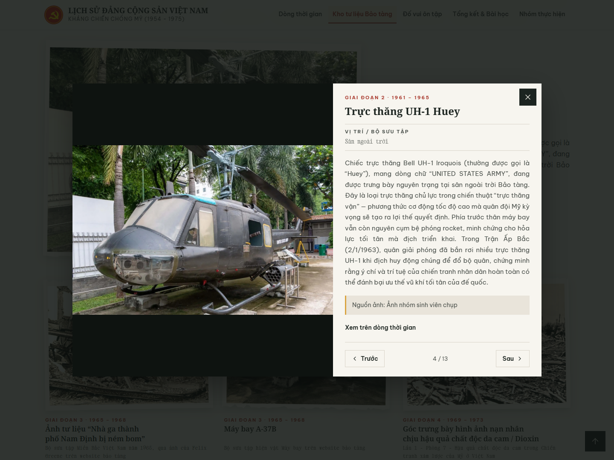

*Hình 4.6. Ảnh phóng lớn, thuyết minh và nguồn tư liệu của trực thăng UH-1 Huey. Nguồn: website của nhóm, chụp ngày 23/11/2026.*

Giá trị của kho tư liệu không chỉ nằm ở khả năng xem ảnh. Việc đặt chú thích và thông tin lịch sử cạnh hình ảnh giúp người học đặt câu hỏi: tư liệu phản ánh vấn đề gì, thuộc bối cảnh nào và có thể minh họa cho luận điểm nào trong giáo trình. Đây là sự tiếp nối phương pháp đối chiếu giữa đường lối và thực tiễn đã trình bày ở phần 1.

### 3.3 Trắc nghiệm ôn tập có phản hồi giải thích

Phần Đố vui ôn tập gồm **19 câu hỏi trắc nghiệm**, xoay quanh các nghị quyết, chủ trương và sự kiện trọng tâm. Mỗi câu có bốn phương án, chỉ chọn một đáp án. Giao diện hiển thị thời kỳ, số thứ tự câu, điểm hiện tại và thanh tiến độ để người học theo dõi quá trình làm bài.

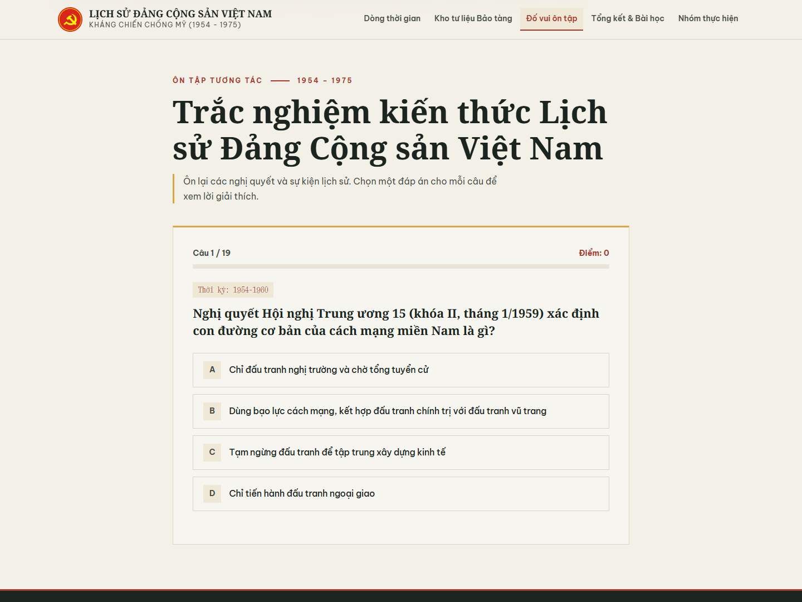

*Hình 4.7. Câu đầu tiên trong bộ 19 câu hỏi ôn tập. Nguồn: website của nhóm, chụp ngày 23/11/2026.*

Sau khi chọn, các phương án được khóa để tránh thay đổi hoặc tính điểm lặp lại. Hệ thống đánh dấu đáp án đúng; nếu chọn sai, phương án đã chọn được phân biệt với đáp án đúng và có thông báo bằng chữ. Phần giải thích xuất hiện ngay sau đó, giúp người học nhận biết căn cứ của đáp án trước khi chuyển câu. Như vậy, bài ôn tập không chỉ trả về điểm số mà còn cung cấp phản hồi để sửa nhận thức chưa chính xác.

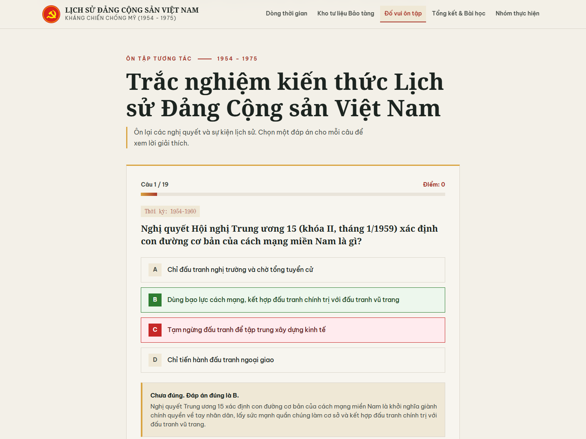

*Hình 4.8. Lựa chọn sai được phân biệt với đáp án đúng, kèm giải thích. Nguồn: website của nhóm, chụp ngày 23/11/2026.*

Khi hoàn thành, website hiển thị số câu đúng trên tổng số câu và nhận xét tương ứng. Trong lượt thao tác minh họa, câu đầu được cố ý chọn sai và 18 câu còn lại chọn đúng; hệ thống trả về **18/19**, phù hợp với cách tính một điểm cho mỗi câu đúng. Đây là kết quả kiểm tra chức năng của một lượt chạy, không phải số liệu khảo sát người học hay bằng chứng đo lường hiệu quả đào tạo.

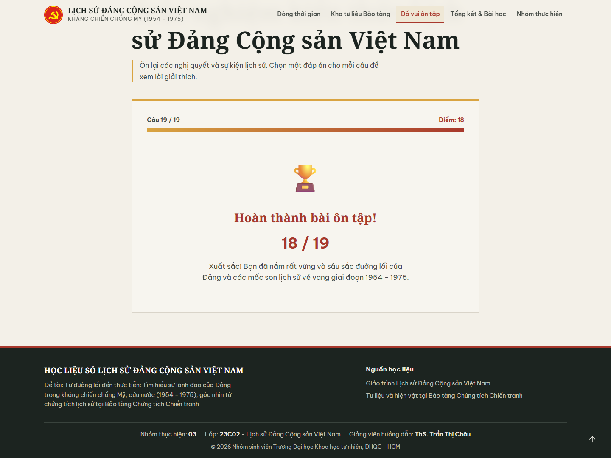

*Hình 4.9. Màn hình kết quả của lượt kiểm tra minh họa 18/19. Nguồn: website của nhóm, chụp ngày 23/11/2026.*

### 3.4 Tổng kết và bài học kinh nghiệm

Khu vực Tổng kết & Bài học giúp người học chuyển từ theo dõi từng giai đoạn sang khái quát toàn bộ tiến trình. Nội dung bao gồm đánh giá vai trò lãnh đạo của Đảng, bốn nguyên nhân thắng lợi, ý nghĩa lịch sử và năm bài học kinh nghiệm. Mục lục bên cạnh hỗ trợ chuyển nhanh giữa các chủ đề; phần cuối có liên kết sang hoạt động ôn tập.

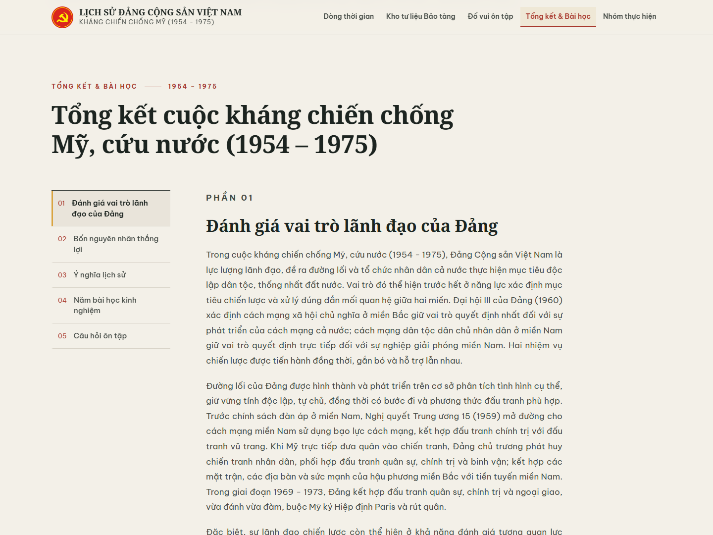

*Hình 4.10. Khu vực tổng kết với mục lục điều hướng theo chủ đề. Nguồn: website của nhóm, chụp ngày 23/11/2026.*

Chức năng này gắn với nội dung phần 3 của báo cáo: các sự kiện không được xem như những mốc rời rạc mà là cơ sở để nhận diện quan hệ giữa mục tiêu chiến lược, phương pháp đấu tranh, sức mạnh nhân dân và tổ chức thực hiện. Việc bố trí phần tổng kết ngay trên website tạo điều kiện đối chiếu giữa kiến thức chi tiết và nhận định khái quát.

### 3.5 Giới thiệu nhóm và hiển thị trên thiết bị di động

Trang Nhóm thực hiện giới thiệu tập thể nhóm 03, lớp 23C02, gồm 10 thành viên. Thông tin thành viên gắn với vai trò và nhiệm vụ, từ biên soạn nội dung, xây dựng giao diện và chức năng đến điều phối, tổng hợp báo cáo. Ảnh tập thể tại bảo tàng bổ sung dấu ấn của quá trình khảo sát thực tế.

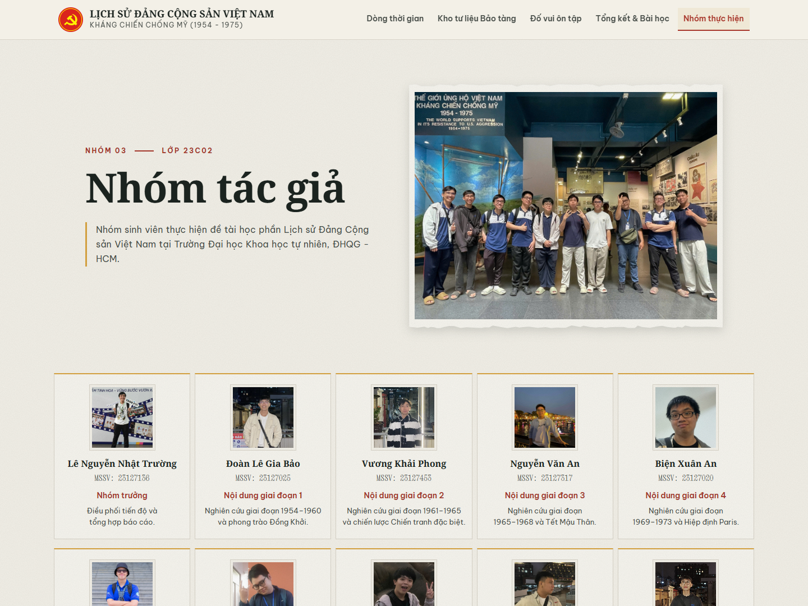

*Hình 4.11. Trang nhóm tác giả với ảnh tập thể và các thẻ thành viên. Nguồn: website của nhóm, chụp ngày 23/11/2026.*

Giao diện có điều chỉnh bố cục theo kích thước màn hình và menu thu gọn trên thiết bị di động. Khi kiểm tra trên **giao diện điện thoại**, menu mở và chuyển được sang phần Đố vui ôn tập; nội dung trang không gây tràn ngang. Kết quả này xác nhận thao tác cơ bản ở một kích thước màn hình, chưa đại diện cho mọi thiết bị và trình duyệt.

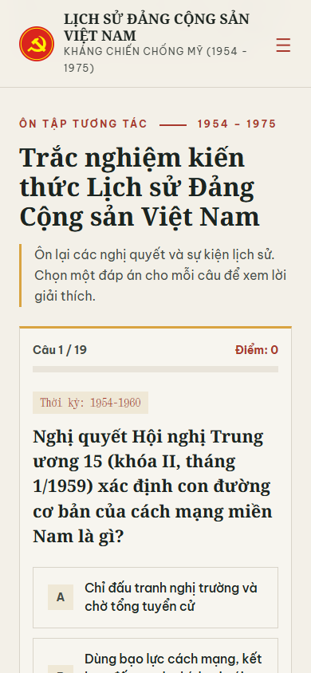

*Hình 4.12. Phần ôn tập trên giao diện điện thoại. Nguồn: website của nhóm, chụp ngày 23/11/2026.*

## 4 Đánh giá kết quả và khả năng ứng dụng

### Kết quả kiểm tra các thao tác chính

Việc kiểm tra được thực hiện trực tiếp trên bản đã triển khai bằng trình duyệt Microsoft Edge ngày 23/11/2026, với khung nhìn máy tính 1440 × 1080 pixel và khung nhìn di động nêu trên. Các kết quả dưới đây phản ánh phạm vi thao tác đã kiểm tra, không thay thế một đợt đánh giá toàn diện về hiệu năng, bảo mật hoặc khả năng tiếp cận.

| Thao tác kiểm tra | Kết quả ghi nhận |
| --- | --- |
| Truy cập địa chỉ triển khai | Trang phản hồi HTTP 200 và hiển thị nội dung |
| Chọn giai đoạn trên thước thời gian | Chuyển đến nội dung giai đoạn 1961 - 1965 |
| Mở chi tiết sự kiện | Hiển thị nội dung Chiến thắng Ấp Bắc; đóng được bằng phím Escape |
| Duyệt kho tư liệu và thẻ nổi bật | Hiển thị 13 mục có nhãn giai đoạn; trực thăng UH-1 Huey được làm nổi bật |
| Mở chi tiết tư liệu | Hiển thị ảnh, thuyết minh và nguồn; đóng được bằng phím Escape |
| Trả lời trắc nghiệm | Có phản hồi, giải thích và khóa bốn lựa chọn sau khi trả lời |
| Hoàn thành toàn bộ 19 câu | Lượt minh họa 18 câu đúng, 1 câu sai trả về 18/19 |
| Chọn mục Năm bài học kinh nghiệm | Chuyển đến phần tương ứng trong khu vực tổng kết |
| Điều hướng trên khung nhìn di động | Menu thu gọn hoạt động, mở được phần ôn tập |

### Giá trị hỗ trợ học tập

Website tạo một lộ trình có thể sử dụng khi tự học: **đọc tiến trình → xem tư liệu liên quan → tổng hợp kiến thức → trả lời câu hỏi → đọc giải thích và xem lại nội dung**. Người học được lựa chọn điểm bắt đầu theo nhu cầu, còn các giai đoạn và mục lục giúp duy trì định hướng. Trong thảo luận nhóm, dòng thời gian và hộp chi tiết có thể được dùng để minh họa luận điểm, kết hợp với phần thuyết trình của sinh viên.

So với tập hợp tài liệu rời, sản phẩm có ưu điểm là đặt nội dung nghiên cứu, hình ảnh và ôn tập trong một môi trường truy cập chung. Tuy nhiên, giá trị hiện được xác định ở khả năng tổ chức và hỗ trợ hoạt động học tập; nhóm chưa có khảo sát đủ cơ sở để kết luận website làm tăng điểm số hoặc mức độ ghi nhớ. Giáo trình và hướng dẫn của giảng viên vẫn là nền tảng học thuật, còn điểm trắc nghiệm chỉ phục vụ tự kiểm tra.

### Hạn chế và hướng phát triển

Phạm vi học liệu và bộ 19 câu hỏi còn giới hạn, chưa bao quát toàn bộ yêu cầu của học phần. Nguồn ảnh và thuyết minh cần tiếp tục được rà soát, đặc biệt là việc phân biệt ảnh hiện vật, ảnh tư liệu và hình minh họa; trích nguồn không thay thế yêu cầu tuân thủ quyền sử dụng hình ảnh. Những hiệu ứng chuyển động cũng cần được kiểm tra thêm trên thiết bị cấu hình thấp và với người dùng có nhu cầu tiếp cận khác nhau.

Trong các lần hoàn thiện tiếp theo, nhóm có thể ưu tiên hiệu đính nội dung, chuẩn hóa nguồn trích dẫn, mở rộng câu hỏi theo chủ đề và bổ sung chức năng xem lại câu trả lời sai. Việc lưu tiến độ cá nhân hoặc thống kê kết quả chỉ nên phát triển khi có nhu cầu rõ ràng và phương án bảo vệ dữ liệu phù hợp. Trước mắt, trọng tâm vẫn là độ chính xác của học liệu, tính rõ ràng của giao diện và khả năng sử dụng các chức năng cốt lõi.

# PHẦN 5 KẾT LUẬN VÀ CẢM NGHĨ CỦA NHÓM

## 1 Kết luận

Đề tài đã kết hợp nghiên cứu lịch sử với việc xây dựng một sản phẩm học liệu số có thể truy cập và sử dụng trên trình duyệt. Phần nội dung hệ thống hóa sự lãnh đạo của Đảng qua năm giai đoạn kháng chiến chống Mỹ, cứu nước; phần sản phẩm chuyển nội dung đó thành dòng thời gian tương tác, kho tư liệu, bài tổng kết và hoạt động trắc nghiệm có giải thích. Website vì vậy là kết quả ứng dụng trực tiếp của quá trình chọn lọc, tổ chức và trình bày tri thức mà nhóm đã thực hiện.

Kết quả nổi bật của nhóm không chỉ là một địa chỉ web được triển khai, mà còn là sự kết nối giữa các hình thức tiếp cận: đọc để nắm tiến trình, quan sát để hình dung chứng tích và tự kiểm tra để nhận ra nội dung cần củng cố. Qua đó, mục tiêu “từ đường lối đến thực tiễn” được thể hiện cả trong nội dung lịch sử lẫn cách tổ chức hoạt động học tập. Những chức năng đã kiểm tra cho thấy sản phẩm đáp ứng các thao tác cơ bản trong phạm vi đề tài; việc đánh giá hiệu quả học tập thực tế cần được tiếp tục bằng phản hồi và khảo sát người sử dụng.

## 2 Cảm nghĩ sau quá trình khảo sát và xây dựng sản phẩm

Qua việc tìm hiểu chứng tích tại Bảo tàng Chứng tích Chiến tranh, nhóm nhận thức rõ hơn rằng các mốc lịch sử trong giáo trình gắn với đời sống, sự hy sinh và những mất mát cụ thể của con người. Các hiện vật, ảnh tư liệu và nội dung trưng bày giúp việc học không dừng lại ở tên gọi của một chiến lược hay kết quả của một chiến dịch. Đằng sau đó là những nỗ lực bền bỉ của nhân dân, sự phối hợp giữa hậu phương và tiền tuyến, cùng khát vọng độc lập, thống nhất và hòa bình.

Những ghi nhận ấy làm sâu sắc lòng biết ơn của nhóm đối với các thế hệ đi trước, đồng thời nhắc nhở trách nhiệm khi chuyển tư liệu thành nội dung số. Một hình ảnh không nên chỉ được dùng để tạo ấn tượng; nó cần có bối cảnh và chú thích phù hợp. Một câu hỏi trắc nghiệm không chỉ cần đáp án đúng mà còn cần giải thích rõ. Với nhóm, thái độ nghiêm túc trong kiểm chứng và trình bày kiến thức cũng là cách thể hiện sự tôn trọng lịch sử và người học.

Quá trình xây dựng website còn cho thấy giá trị của hợp tác. Nội dung, thiết kế và lập trình chỉ tạo thành sản phẩm khi được phối hợp và rà soát cùng nhau. Các thành viên có cơ hội rèn luyện kỹ năng phân công, tổng hợp tài liệu, trao đổi và chịu trách nhiệm đối với phần việc chung. Việc vận dụng công nghệ vào môn học giúp nhóm nhận thấy chuyên môn của sinh viên có thể góp phần làm cho học liệu dễ tiếp cận hơn, nhưng không thay thế yêu cầu nghiên cứu nghiêm túc.

Từ trải nghiệm đó, nhóm xác định trách nhiệm của người trẻ bắt đầu từ những việc cụ thể: học tập có mục tiêu, sử dụng thông tin có kiểm chứng, tôn trọng con người và đóng góp bằng năng lực của mình. Trân trọng hòa bình không chỉ là cảm xúc trước chứng tích chiến tranh mà còn là ý thức gìn giữ, xây dựng cuộc sống hôm nay và ứng xử có trách nhiệm trong cộng đồng.

## 3 Lời cảm ơn

Nhóm xin trân trọng cảm ơn Ban Giám hiệu Trường Đại học Khoa học Tự nhiên, Đại học Quốc gia Thành phố Hồ Chí Minh; quý Thầy, Cô phụ trách học phần Lịch sử Đảng Cộng sản Việt Nam đã tạo điều kiện để sinh viên kết hợp học tập lý luận với tìm hiểu thực tế. Nhóm cảm ơn Bảo tàng Chứng tích Chiến tranh đã gìn giữ, trưng bày và giới thiệu hệ thống tư liệu giúp công chúng tiếp cận lịch sử từ những chứng tích cụ thể.

Nhóm cũng cảm ơn sự phối hợp và đóng góp của các thành viên trong quá trình biên soạn nội dung, khảo sát, xây dựng và hoàn thiện website. Dù đã nỗ lực thực hiện, sản phẩm và báo cáo vẫn có thể còn hạn chế. Nhóm mong nhận được góp ý của giảng viên và người học để tiếp tục hiệu đính, hoàn thiện học liệu theo hướng chính xác, rõ ràng và hữu ích hơn.

## Tài liệu bổ sung cho phần 4 và phần 5

[3] Nhóm 03, lớp 23C02 (2026), *Website học liệu Từ đường lối đến thực tiễn*, [bản triển khai trên Vercel](https://nhom03-lsd-23c02.vercel.app/), truy cập và chụp màn hình ngày 23/11/2026.
