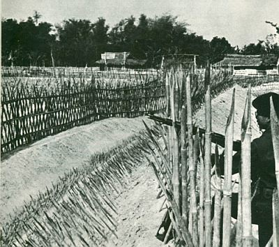
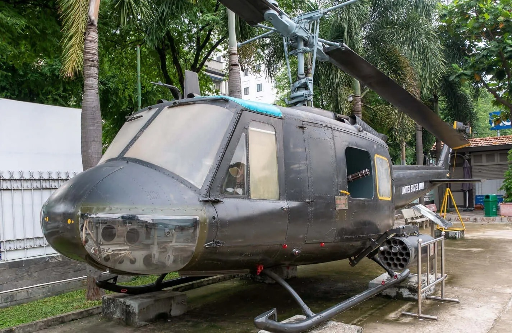

# PHIẾU THU THẬP NỘI DUNG & TƯ LIỆU - GIAI ĐOẠN 2 (1961 - 1965)

* **Thành viên phụ trách:** **Phong**  
* **Giai đoạn:** Lãnh đạo đánh bại chiến lược "Chiến tranh đặc biệt" của đế quốc Mỹ (1961 - 1965)  
* **Hạn nộp bài hoàn chỉnh:** **23:59 - 20/11/2026**  
* **Tài liệu tham khảo:** Giáo trình Lịch sử Đảng Cộng sản Việt Nam (Chương 2) & Chuyến khảo sát thực tế Bảo tàng Chứng tích Chiến tranh  
* **Thư mục ảnh:** [./images/](./images/)  
* **Kế hoạch chung:** [PHAN_CONG.md](../../PHAN_CONG.md)

---

## 1. Bối cảnh lịch sử
> *Gợi ý định hướng nghiên cứu:*
> - Sau thất bại của phong trào Đồng Khởi, Mỹ chuyển sang áp dụng chiến lược chiến tranh nào? Tổng thống Mỹ nào đề xướng?
> - Bản chất và công thức của "Chiến tranh đặc biệt" là gì? (Quân đội nào tác chiến? Dưới sự chỉ huy của ai? Dựa vào vũ khí gì?)
> - Âm mưu của kế hoạch Staley-Taylor và Johnson-McNamara? Quốc sách "Ấp chiến lược" đóng vai trò như thế nào?
> - Các chiến thuật cơ động mới của Mỹ ("trực thăng vận", "thiết xa vận") được áp dụng ra sao?

**Nội dung bạn tự soạn:**

Bước sang năm 1961, trước thất bại của hình thức thực dân mới điển hình, đế quốc Mỹ dưới thời Tổng thống John F. Kennedy chuyển hướng áp dụng chiến lược **"Chiến tranh đặc biệt"** (*Special War Strategy*) — một bộ phận trong chiến lược toàn cầu "Phản ứng linh hoạt". Đây là hình thức chiến tranh dựa trên công thức: **"cố vấn và vũ khí Mỹ + quân chủ lực Việt Nam Cộng hòa"**, nhằm dùng người Việt đánh người Việt dưới sự chỉ huy và hỗ trợ của người Mỹ.

Để triển khai chiến lược này, Mỹ và chính quyền Ngô Đình Diệm thực hiện hai kế hoạch quân sự-chính trị liên tiếp:
- **Kế hoạch Staley-Taylor (1961-1963):** Bình định miền Nam trong 18 tháng, xây dựng hệ thống **17.000 ấp chiến lược** làm "quốc sách" nhằm tách rời nhân dân khỏi lực lượng cách mạng.
- **Kế hoạch Johnson-McNamara (1964-1965):** Đẩy mạnh quy mô chiến tranh, tăng cường cố vấn và viện trợ quân sự.

Về mặt chiến thuật, địch áp dụng hai phương thức cơ động mới là **"trực thăng vận"** (sử dụng trực thăng UH-1 đổ bộ nhanh) và **"thiết xa vận"** (sử dụng xe bọc thép M113 đột phá vào căn cứ ta), gây cho cách mạng miền Nam không ít khó khăn, đặc biệt trong hai năm 1961-1962. Từ ngày 10-8-1961, Mỹ còn bắt đầu rải chất độc da cam/Dioxin xuống miền Nam, gây thảm họa môi trường và nhân đạo nghiêm trọng kéo dài đến nhiều thế hệ.

*Nguồn tài liệu trích dẫn (ref.md):*
- Đoạn bắt đầu: **"Ở miền Nam, từ năm 1961..."** → ref.md, dòng 344 (Trang 200, 201 trong giáo trình)

---

## 2. Chủ trương & Đường lối của Đảng
> *Gợi ý định hướng nghiên cứu:*
> - Các chỉ thị của Bộ Chính trị (tháng 1/1961 và 2/1962) đã xác định phương châm tác chiến ra sao?
> - Phân tích nội dung và ý nghĩa chiến lược của phương châm tác chiến trên **3 vùng chiến lược** (rừng núi, nông thôn đồng bằng, đô thị)?
> - Phân tích phương thức tiến công địch bằng **"ba mũi giáp công"** (quân sự, chính trị, binh vận)?
> - Quyết tâm đánh Mỹ tại Hội nghị Trung ương 9 (12/1963)?

**Nội dung bạn tự soạn:**

Trước âm mưu và hành động leo thang của địch, Đảng đã kịp thời đề ra đường lối lãnh đạo sắc bén, chủ động và sáng tạo.

**Chỉ thị của Bộ Chính trị (tháng 1/1961 và tháng 2/1962):**
Trong hai hội nghị Bộ Chính trị vào tháng 1-1961 và tháng 2-1962, Đảng phân tích, đánh giá sâu sắc tình hình miền Nam sau Đồng Khởi và ban hành chỉ thị về *"Phương hướng và nhiệm vụ công tác trước mắt của cách mạng miền Nam"*. Tinh thần cốt lõi là: **giữ vững thế tiến công chiến lược**, đưa đấu tranh vũ trang phát triển song song với đấu tranh chính trị. Đây thực chất là quyết định lịch sử chuyển cuộc đấu tranh của nhân dân miền Nam **từ khởi nghĩa từng phần sang chiến tranh cách mạng**.

**Phương châm tác chiến trên ba vùng chiến lược:**
Đảng xác định tiến công địch trên cả **ba vùng chiến lược** với phương thức phù hợp từng địa bàn:
- **Vùng rừng núi:** Lấy đấu tranh vũ trang làm chủ yếu.
- **Vùng nông thôn đồng bằng:** Kết hợp đấu tranh vũ trang và chính trị.
- **Vùng đô thị:** Lấy đấu tranh chính trị làm chủ yếu.

**Ba mũi giáp công:** Toàn bộ hoạt động được triển khai đồng thời bằng **ba mũi**: quân sự, chính trị và binh vận — tạo nên sức mạnh tổng hợp, toàn diện, áp đảo kẻ thù từ nhiều hướng.

**Hội nghị Trung ương lần thứ 9 (12/1963):**
Tháng 12-1963, Trung ương Đảng họp Hội nghị lần thứ 9, xác định những vấn đề quan trọng về đường lối cách mạng miền Nam. Nghị quyết khẳng định: **"đấu tranh vũ trang đóng vai trò quyết định trực tiếp"** thắng lợi trên chiến trường — thể hiện quyết tâm sắt đá đánh thắng đế quốc Mỹ xâm lược.

Để tăng cường sự lãnh đạo trực tiếp, tháng 10-1961, **Trung ương Cục miền Nam** được thành lập do đồng chí Nguyễn Văn Linh làm Bí thư. Ngày 15-2-1961, các lực lượng vũ trang ở miền Nam được thống nhất thành **Quân Giải phóng miền Nam Việt Nam**.

*Nguồn tài liệu trích dẫn (ref.md):*
- Đoạn **"Tháng 1-1961 và tháng 2-1962, các cuộc Hội nghị của Bộ Chính trị..."** → ref.md, dòng 346-357 (Trang 201, 202 trong giáo trình)
- Đoạn **"Tháng 12-1963, Trung ương Đảng họp Hội nghị lần thứ 9..."** → ref.md, dòng 365 (Trang 203, 204, 205 trong giáo trình)

---

## 3. Giá trị thực tiễn & Thắng lợi tiêu biểu
> *Gợi ý định hướng nghiên cứu:*
> - Phong trào phá "Ấp chiến lược" của đồng bào miền Nam đã diễn ra quyết liệt như thế nào?
> - Diễn biến và ý nghĩa lịch sử to lớn của **Chiến thắng Ấp Bắc (2/1/1963)**? Tại sao nói trận Ấp Bắc chứng minh ta có thể đánh bại chiến thuật "trực thăng vận" và "thiết xa vận"?
> - Các chiến dịch tiến công liên tiếp cuối 1964 - đầu 1965: Bình Giã, Ba Gia, Đồng Xoài đã làm sụp đổ hoàn toàn chiến lược "Chiến tranh đặc biệt" như thế nào?
> - Phong trào đấu tranh chính trị ở các đô thị (học sinh, sinh viên, Phật giáo)?

**Nội dung bạn tự soạn:**

Dưới sự lãnh đạo đúng đắn của Đảng, quân và dân miền Nam đã liên tiếp giành được những thắng lợi to lớn, từng bước đánh bại hoàn toàn chiến lược "Chiến tranh đặc biệt".

**Chiến thắng Ấp Bắc (2/1/1963):**
Đây là thắng lợi quân sự vang dội đầu tiên của quân và dân miền Nam, diễn ra tại Mỹ Tho. Trận Ấp Bắc đã thể hiện rõ sức mạnh tổng hợp của đấu tranh **vũ trang kết hợp với đấu tranh chính trị và binh vận**, đồng thời **bác bỏ trên thực tế** hiệu quả của hai chiến thuật "trực thăng vận" và "thiết xa vận" — vũ khí chủ lực mà địch đang đặt nhiều kỳ vọng. Sau trận này, một phong trào "tìm Mỹ mà đánh, lùng ngụy mà diệt" lan rộng khắp chiến trường miền Nam.

**Phong trào phá "Ấp chiến lược":**
Từ đầu năm 1963, quân dân miền Nam đẩy mạnh phong trào phá ấp chiến lược với phương châm **"bám đất, bám làng", "một tấc không đi, một ly không rời"**, trực tiếp làm sụp đổ "quốc sách" then chốt của địch, trả lại quyền làm chủ cho nhân dân ở khắp vùng nông thôn.

**Phong trào đấu tranh chính trị tại đô thị:**
Song song với mặt trận quân sự, phong trào đấu tranh chính trị ở các đô thị bùng phát mạnh mẽ từ giữa năm 1963, lôi cuốn đông đảo học sinh, sinh viên, trí thức, công nhân và đồng bào Phật giáo tham gia, góp phần làm rung chuyển bộ máy kẻ thù từ bên trong.

**Các chiến dịch Bình Giã, Ba Gia, Đồng Xoài (1964-1965):**
Được sự chi viện tích cực từ miền Bắc, quân và dân miền Nam tiến hành hàng loạt chiến dịch: **Bình Giã (12/1964), Ba Gia (5/1965), Đồng Xoài (7/1965)**. Các chiến thắng này đã sáng tạo và khẳng định vững chắc phương châm tác chiến **"2 chân, 3 mũi, 3 vùng"**, đồng thời đánh sập toàn bộ ba trụ cột của chiến lược "Chiến tranh đặc biệt": ngụy quân-ngụy quyền, hệ thống ấp chiến lược, và sự ổn định ở các đô thị.

Đến đầu năm 1965, chiến lược "Chiến tranh đặc biệt" của đế quốc Mỹ đã **hoàn toàn phá sản**, tạo cơ sở vững chắc để cách mạng miền Nam tiếp tục tiến lên giai đoạn mới.

*Nguồn tài liệu trích dẫn (ref.md):*
- Đoạn **"Vượt qua khó khăn, cách mạng miền Nam tiếp tục có bước phát triển mới..."** → ref.md, dòng 359-375 (Trang 202 - 205 trong giáo trình)
- Đoạn **"Được sự chi viện tích cực của miền Bắc..."** → ref.md, dòng 367 (Trang 203, 204 trong giáo trình)

---

## 4. Chứng tích lịch sử tại Bảo tàng Chứng tích Chiến tranh (Khảo sát thực tế)

### Tư liệu 1:
- **Tên hiện vật:** Mô hình Ấp chiến lược
- **Vị trí / Phòng trưng bày tại Bảo tàng:** Phòng tội ác chiến tranh xâm lược
- **Tên file ảnh đính kèm:** 
- **Mô tả hiện vật & Ý nghĩa lịch sử:** 
  Bức ảnh ghi lại hình ảnh hàng rào tre/nứa vót nhọn kết hợp bờ đất đắp cao — đây là cấu trúc phòng thủ điển hình của hệ thống **ấp chiến lược** mà Mỹ và chính quyền Sài Gòn triển khai rầm rộ theo kế hoạch Staley-Taylor (1961-1963), với mục tiêu lập tới 17.000 ấp trên toàn miền Nam. Ấp chiến lược được xây dựng nhằm cô lập nhân dân khỏi lực lượng cách mạng, biến làng xã thành nhà tù kiểm soát dân chúng. Tuy nhiên, dưới sự lãnh đạo của Đảng, quân và dân miền Nam đã kiên trì bám đất, bám làng, đứng lên phá bỏ từng hàng rào, giành lại quyền làm chủ. Đến cuối giai đoạn 1961-1965, "quốc sách" ấp chiến lược đã hoàn toàn thất bại — một trong ba trụ cột cốt lõi của chiến lược "Chiến tranh đặc biệt" bị đánh sập.

### Hiện vật 2:
- **Tên hiện vật:** Trực thăng UH-1 Huey
- **Vị trí / Phòng trưng bày tại Bảo tàng:** Sân ngoài trời
- **Tên file ảnh đính kèm:** 
- **Mô tả hiện vật & Ý nghĩa lịch sử:** 
  Chiếc trực thăng **Bell UH-1 Iroquois** (thường được gọi là "Huey"), mang dòng chữ **"UNITED STATES ARMY"**, đang được trưng bày nguyên trạng tại sân ngoài trời Bảo tàng. Đây là loại trực thăng chủ lực trong chiến thuật **"trực thăng vận"** — phương thức cơ động tốc độ cao mà quân đội Mỹ kỳ vọng sẽ tạo ra lợi thế quyết định. Phía trước thân máy bay vẫn còn nguyên cụm bệ phóng rocket, minh chứng cho hỏa lực tối tân mà địch triển khai. Tuy nhiên, chính chiếc trực thăng này và những đồng loại của nó đã bị quân dân ta đánh bại thực tế tại **Trận Ấp Bắc (2/1/1963)**: dù địch huy động nhiều chiếc UH-1 đổ bộ quân, bộ đội và du kích địa phương vẫn bình tĩnh, kiên quyết chiến đấu, bắn rơi nhiều máy bay, chứng minh rằng ý chí và trí tuệ của chiến tranh nhân dân hoàn toàn có thể đánh bại vũ khí tối tân của đế quốc.

---

## 5. Kiến thức trọng tâm cần nhớ (Phục vụ ôn thi cuối kỳ)

1. **Chiến lược "Chiến tranh đặc biệt" (1961-1965):** Công thức = cố vấn + vũ khí Mỹ + quân chủ lực Việt Nam Cộng hòa; được chia thành 2 kế hoạch: **Staley-Taylor (1961-1963)** và **Johnson-McNamara (1964-1965)**; chiến thuật chủ đạo là "trực thăng vận" và "thiết xa vận".
2. **Chỉ thị của Bộ Chính trị (1/1961 và 2/1962):** Xác định phương châm **ba vùng chiến lược** (rừng núi, nông thôn đồng bằng, đô thị) + **ba mũi giáp công** (quân sự, chính trị, binh vận); đánh dấu bước chuyển từ khởi nghĩa từng phần sang chiến tranh cách mạng.
3. **Nghị quyết Trung ương 9 (12/1963):** Khẳng định đấu tranh vũ trang "đóng vai trò quyết định trực tiếp" — văn kiện thể hiện rõ nhất quyết tâm đánh Mỹ của Đảng trong giai đoạn này.
4. **Chiến thắng Ấp Bắc (2/1/1963):** Thắng lợi quân sự mang tính bước ngoặt, lần đầu tiên đánh bại chiến thuật trực thăng vận và thiết xa vận trên thực địa; khai sinh phong trào "tìm Mỹ mà đánh, lùng ngụy mà diệt".
5. **Phá sản hoàn toàn chiến tranh đặc biệt (đầu 1965):** Sau chuỗi chiến dịch Bình Giã, Ba Gia, Đồng Xoài — cả 3 trụ cột (ngụy quân, ấp chiến lược, đô thị) của địch đều bị lung lay tận gốc → Mỹ buộc phải chuyển sang chiến lược "Chiến tranh cục bộ".

---

## 6. Cảm nghĩ cá nhân sau chuyến tham quan thực tế Bảo tàng

Đứng trước những hiện vật trưng bày tại Bảo tàng Chứng tích Chiến tranh — từ hàng rào tre nhọn của ấp chiến lược đến chiếc trực thăng UH-1 Huey còn nguyên bệ phóng rocket — tôi càng thấm thía hơn tầm vóc của trí tuệ và bản lĩnh Việt Nam. Địch có vũ khí hiện đại, có máy bay, có xe bọc thép; nhưng Đảng ta đã sáng tạo ra phương châm **"ba vùng chiến lược, ba mũi giáp công"** — một nghệ thuật chiến tranh nhân dân toàn diện mà không có ưu thế hỏa lực nào có thể triệt tiêu được. Mỗi ngọn tre trong hàng rào ấp chiến lược bị quân dân ta nhổ bỏ là một lần khẳng định: sức mạnh của lòng dân và đường lối đúng đắn của Đảng mạnh hơn bất kỳ thứ vũ khí nào. Chuyến tham quan này không chỉ giúp tôi hiểu lịch sử qua sách vở, mà còn cảm nhận được nó bằng chính đôi mắt — một trải nghiệm không thể nào quên.
