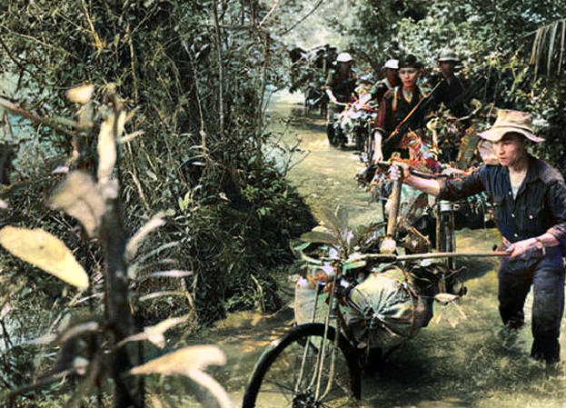
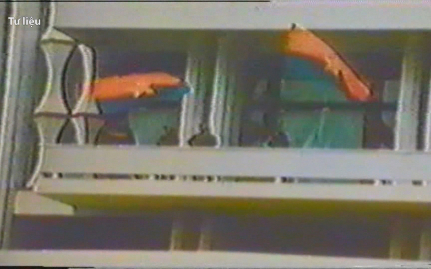
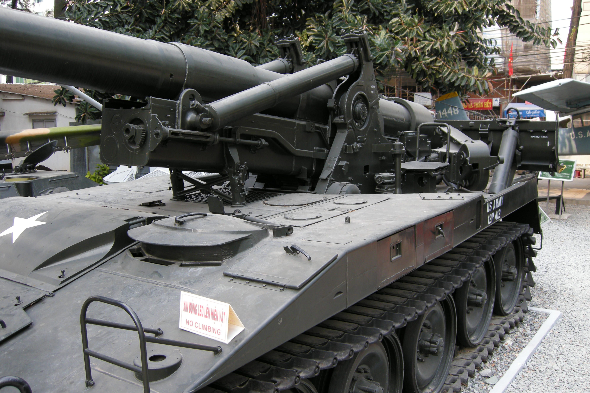
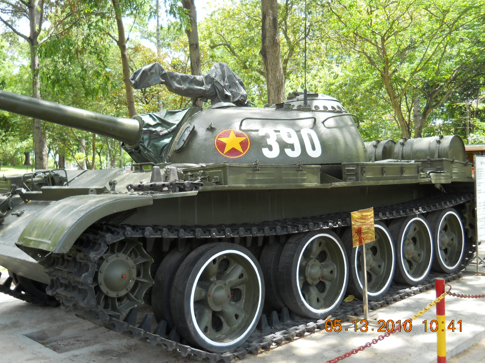
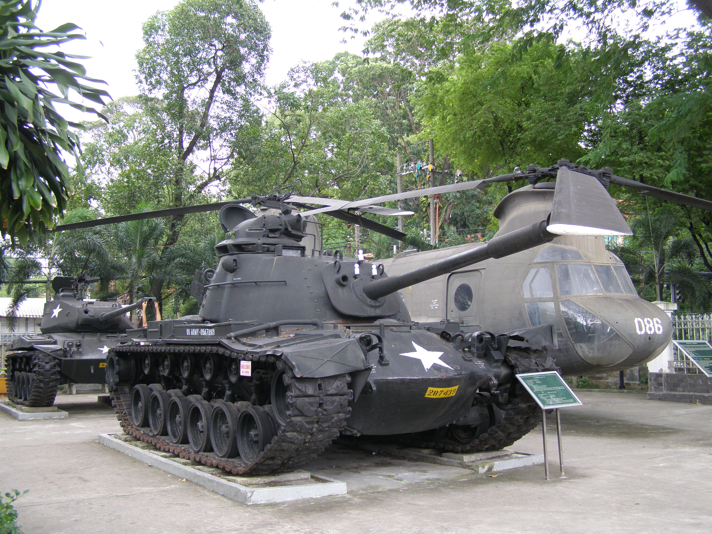
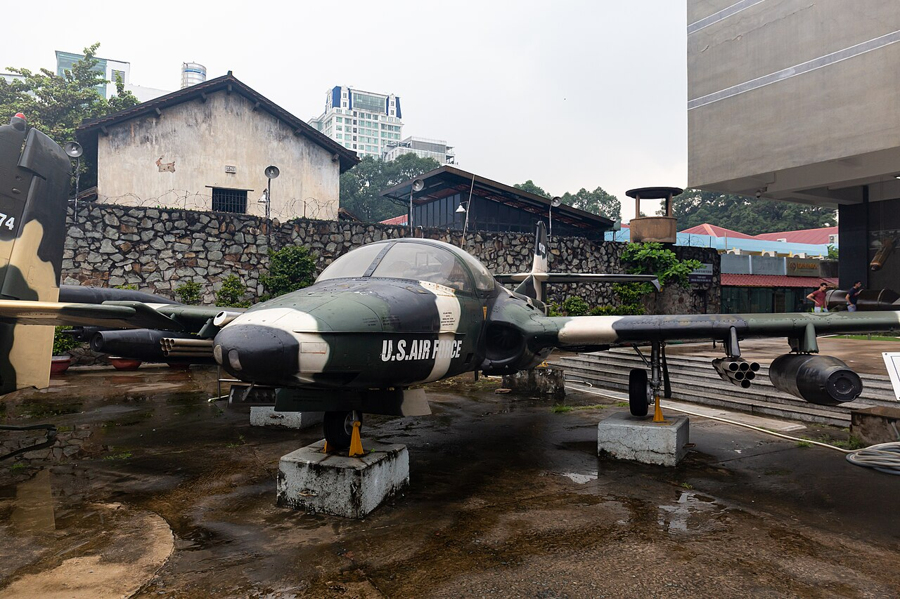
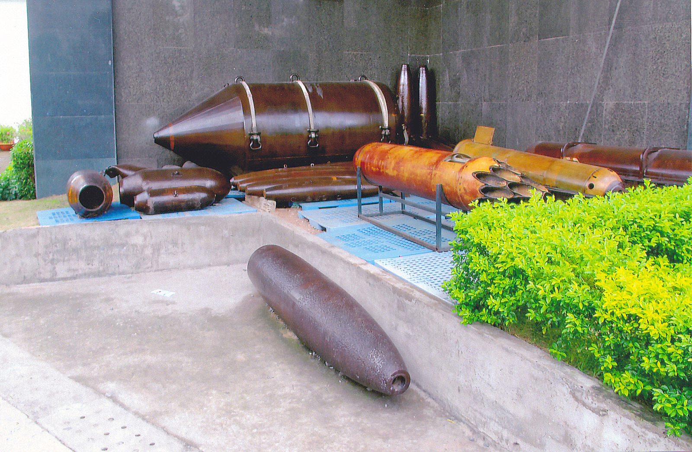
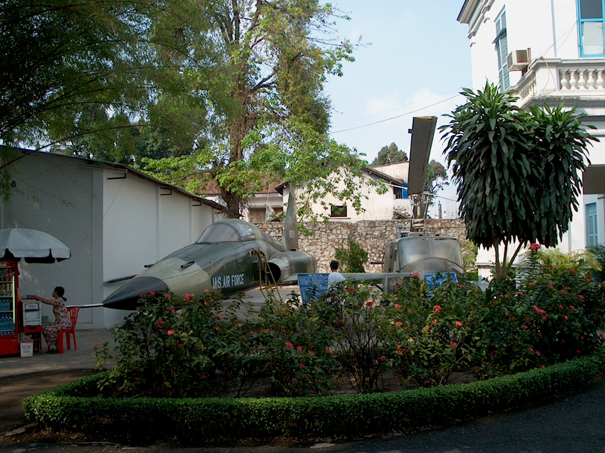

# PHIẾU THU THẬP NỘI DUNG & TƯ LIỆU - GIAI ĐOẠN 5 (1973 - 1975)

- **Thành viên phụ trách:** **Tấn**
- **Giai đoạn:** Tạo thời cơ và mở Cuộc Tổng tiến công và nổi dậy mùa Xuân 1975 giải phóng hoàn toàn miền Nam, thống nhất đất nước
- **Hạn nộp bài hoàn chỉnh:** **23:59 - 20/11/2026**
- **Tài liệu tham khảo chính:**
  - _Giáo trình Lịch sử Đảng Cộng sản Việt Nam_ (Dành cho bậc đại học hệ không chuyên lý luận chính trị, Bộ Giáo dục và Đào tạo, NXB Chính trị quốc gia Sự thật, 2021), Chương 2, tr. 228 - 236.
  - _Văn kiện Đảng toàn tập_, Tập 34, 35, 36 (NXB Chính trị quốc gia, Hà Nội).
  - _Tổng hành dinh trong Mùa xuân toàn thắng_ — Đại tướng Võ Nguyên Giáp (NXB Chính trị quốc gia, 2000).
  - Khảo sát thực tế hiện vật và tư liệu tại **Bảo tàng Chứng tích Chiến tranh** (28 Võ Văn Tần, P. Võ Thị Sáu, Q.3, TP.HCM) và Cổng thông tin Bảo tàng ([baotangchungtichchientranh.vn](https://www.baotangchungtichchientranh.vn/vi)).
  - Khảo sát thực tế di tích lịch sử **Hội trường Thống Nhất (Dinh Độc Lập)** (135 Nam Kỳ Khởi Nghĩa, P. Bến Thành, Q.1, TP.HCM).
- **Bản đồ tra cứu & Đối chiếu trích dẫn chi tiết (Ref Map):** [./ref/README.md](./ref/README.md) _(Bảng đối chiếu toàn diện 18 chunks `chuong_2_0524` - `chuong_2_0541`, trang 228 - 236 giáo trình, văn kiện Đảng và metadata 8 ảnh)_
- **Thư mục ảnh:** [./images/](./images/)

---

## 1. Bối cảnh lịch sử

Sau khi **Hiệp định Paris** được ký kết ngày 27/1/1973, đế quốc Mỹ buộc phải công nhận độc lập, chủ quyền, thống nhất và toàn vẹn lãnh thổ của nước Việt Nam và rút toàn bộ quân viễn chinh Mỹ cùng quân các nước đồng minh về nước (hoàn tất ngày 29/3/1973). Sự kiện này đã tạo nên một bước ngoặt lịch sử mang tính thời đại: hoàn thành xuất sắc mục tiêu chiến lược thứ nhất mà Chủ tịch Hồ Chí Minh đã căn dặn trong Di chúc thiêng liêng — **"Đánh cho Mỹ cút"**.

Tuy nhiên, bối cảnh cách mạng miền Nam bước vào giai đoạn 1973 - 1975 đan xen giữa những thời cơ ngàn năm có một cùng muôn vàn khó khăn, thử thách gay gắt:

### 1.1. Bối cảnh quốc tế: Sự suy thoái toàn diện của đế quốc Mỹ

- **Nội tình nước Mỹ khủng hoảng sâu sắc:** Sau thất bại quân sự nặng nề tại Việt Nam, tâm lý "hội chứng Việt Nam" (_Vietnam Syndrome_) bao trùm toàn xã hội Mỹ, phong trào phản chiến dâng cao chưa từng thấy. Đặc biệt, **vụ bê bối Watergate** (1972 - 1974) chấn động chính trường đã buộc Tổng thống Richard Nixon phải từ chức ngày 9/8/1974. Người kế nhiệm là Gerald Ford đối mặt với vô vàn khó khăn đối nội, uy tín chính trị sụt giảm nghiêm trọng, hoàn toàn bất lực trong việc can thiệp quân sự trở lại Việt Nam.
- **Quốc hội Mỹ cắt giảm mạnh viện trợ cho chính quyền Sài Gòn:** Viện trợ quân sự của Mỹ bị cắt giảm lũy tiến từ 2,27 tỷ USD (năm tài chính 1973) xuống còn 1,01 tỷ USD (1974) và chỉ còn khoảng 700 triệu USD (1975). Tình trạng "thiếu đạn, thiếu xăng" khiến quân đội Sài Gòn tê liệt: hỏa lực pháo binh giảm tới 70%, số giờ bay quân sự giảm 50%, nhiều xe tăng, máy bay và tàu chiến phải niêm cất vì không có nhiên liệu và phụ tùng thay thế. Tinh thần chiến đấu của sĩ quan và binh lính ngụy sa sút thảm hại.
- **Xu thế hòa hoãn quốc tế (_Détente_):** Cục diện quan hệ giữa các nước lớn bước vào giai đoạn hòa hoãn, phong trào phản chiến và ủng hộ Việt Nam của nhân dân tiến bộ toàn thế giới dâng cao, cô lập hoàn toàn chính quyền độc tài Nguyễn Văn Thiệu.

### 1.2. So sánh tương quan lực lượng thay đổi căn bản có lợi cho cách mạng

- **Lực lượng vũ trang cách mạng phát triển vượt bậc:** Lần đầu tiên sau gần hai thập kỷ, quân dân miền Nam không còn phải đối đầu trực tiếp trên bộ với quân đội viễn chinh Mỹ sở hữu hỏa lực không quân, pháo binh áp đảo. Lực lượng vũ trang giải phóng tiếp tục giữ vững thế đứng chân xen kẽ theo hình thái "da báo"; hệ thống căn cứ địa cách mạng được mở rộng liên hoàn từ Trị - Thiên, Tây Nguyên, miền Đông Nam Bộ đến đồng bằng sông Cửu Long.
- **Hậu phương lớn miền Bắc dốc toàn lực cho tiền tuyến lớn miền Nam:** Sau khi đập tan cuộc tập kích chiến lược B-52 của Mỹ trong trận "Điện Biên Phủ trên không" (12/1972), miền Bắc nhanh chóng khôi phục kinh tế, phát triển công nông nghiệp và huy động cao nhất sức người, sức của chi viện cho chiến trường miền Nam với khẩu hiệu bất hủ: _"Thóc không thiếu một cân, quân không thiếu một người"_.

_Hình 1: Đoàn quân giải phóng cùng các đoàn xe vận tải cơ giới vượt dãy Trường Sơn huyền thoại chi viện cho chiến trường miền Nam giai đoạn 1973 - 1975 (Ảnh tư liệu lịch sử)._

- **Kỳ tích tuyến vận tải chiến lược Trường Sơn (Đoàn 559):** Tuyến đường Trường Sơn được nâng cấp thành mạng lưới đường bộ cơ giới quy mô lớn cả Đông và Tây Trường Sơn; tuyến Đông Trường Sơn thông suốt từ Đường 9 (Quảng Trị) vào tận Lộc Ninh (miền Đông Nam Bộ). Đặc biệt, hệ thống **đường ống dẫn xăng dầu dài hơn 5.000 km** nối từ miền Bắc xuyên qua dãy Trường Sơn vào tận chiến trường Nam Bộ — một công trình kỳ tích bảo đảm dòng nhiên liệu liên tục cho hàng vạn xe tăng, thiết giáp, pháo binh và xe cơ giới của các quân đoàn chủ lực. Hàng chục vạn tấn vũ khí hạng nặng, đạn dược được vận chuyển thần tốc vào chiến trường.

### 1.3. Âm mưu phá hoại Hiệp định Paris của chính quyền Nguyễn Văn Thiệu

- Mặc dù Mỹ buộc phải rút quân, nhưng chính quyền hiếu chiến Nguyễn Văn Thiệu vẫn được Mỹ hậu thuẫn và để lại gần 20.000 cố vấn quân sự núp bóng dân sự. Thiệu ngang ngược tuyên bố chính sách "Bốn không" (Không hòa hợp, không cộng sản, không mất đất, không trung lập), rêu rao kế hoạch "tràn ngập lãnh thổ" và coi Hiệp định Paris chỉ là "ngừng bắn trên giấy tờ".
- Ngay sau ngày 27/1/1973, địch liên tiếp mở hàng vạn cuộc hành quân lấn chiếm vùng giải phóng (điển hình là đánh chiếm cảng Cửa Việt - Quảng Trị đêm 27/1/1973). Tại các vùng tạm chiếm, địch ráo riết càn quét, bắt bớ, khủng bố dã man các tầng lớp nhân dân yêu nước. Hành động ngoan cố của địch buộc Đảng ta phải có những quyết sách chiến lược kịp thời và kiên quyết để bảo vệ thành quả cách mạng.

_Nguồn tài liệu trích dẫn:_

- Giáo trình Lịch sử Đảng Cộng sản Việt Nam (Chương 2, tr. 228 - 230).
- chunks.json: `chuong_2_0524` (Hiệp định Paris & âm mưu kế hoạch 3 năm của địch), `chuong_2_0525` (Thiệu phá hoại Hiệp định), `chuong_2_0528` (thành lập quân đoàn chủ lực & tuyến Đông Trường Sơn), `chuong_2_0529` (đường ống xăng dầu Trường Sơn).
- Đối chiếu chi tiết tại: [./ref/README.md](./ref/README.md) (Mục 2, STT 1, 2, 5, 6).

---

## 2. Chủ trương & Đường lối chiến lược của Đảng

Trong giai đoạn mang tính bước ngoặt sinh tử này, Ban Chấp hành Trung ương Đảng và Bộ Chính trị đã thể hiện tài năng lãnh đạo kiệt xuất, tư duy biện chứng sắc bén và nghệ thuật quân sự tài tình:

### 2.1. Nghị quyết Trung ương 21 (tháng 7/1973) — Ngọn đuốc định hướng bạo lực cách mạng

- Sau Hiệp định Paris, trong nội bộ cán bộ và nhân dân từng xuất hiện tâm lý ngập ngừng, ảo tưởng về khả năng hòa bình, thiếu cảnh giác trước các đòn lấn chiếm của địch. Tháng 7/1973, Hội nghị Ban Chấp hành Trung ương Đảng lần thứ 21 (khóa III) đã kịp thời định hướng:
  > **"Con đường cách mạng của nhân dân miền Nam là con đường bạo lực cách mạng."**
- Trung ương nhấn mạnh: Bất luận trong tình huống nào cũng phải **nắm vững thời cơ, giữ vững đường lối chiến lược tiến công**. Nhiệm vụ cơ bản là kiên quyết phản công và tiến công địch, giữ vững và mở rộng vùng giải phóng, phát triển thế và lực cách mạng, chuẩn bị tiến lên giải phóng hoàn toàn miền Nam.
- Nghị quyết 21 là quyết sách bản lề, giải tỏa mọi băn khoăn tư tưởng, thống nhất ý chí toàn Đảng, toàn quân, thổi bùng ngọn lửa tiến công trên khắp các chiến trường.

### 2.2. Xây dựng các "quả đấm thép" — Thành lập các quân đoàn chủ lực cơ động

Để chuyển từ phương thức tác chiến phân tán sang tác chiến hiệp đồng quân binh chủng quy mô lớn, từ cuối năm 1973, Bộ Chính trị và Quân ủy Trung ương đã chỉ đạo thành lập 4 quân đoàn chủ lực cơ động:

- **Quân đoàn 1 (Binh đoàn Quyết Thắng)** — Thành lập ngày 24/10/1973 tại Ninh Bình.
- **Quân đoàn 2 (Binh đoàn Hương Giang)** — Thành lập ngày 17/5/1974 tại Thừa Thiên.
- **Quân đoàn 3 (Binh đoàn Tây Nguyên)** — Thành lập ngày 26/3/1975 tại Tây Nguyên.
- **Quân đoàn 4 (Binh đoàn Cửu Long)** — Thành lập ngày 20/7/1974 tại miền Đông Nam Bộ.

Mỗi quân đoàn đều được trang bị đầy đủ các binh chủng kỹ thuật hiện đại: xe tăng thiết giáp, pháo tầm xa, pháo cao xạ, công binh, thông tin liên lạc, tạo thành những quả đấm chiến lược có sức công phá vô song, đủ sức đè bẹp các tập đoàn phòng ngự kiên cố nhất của đối phương.

### 2.3. Kế hoạch chiến lược giải phóng miền Nam trong hai năm 1975 - 1976

Tại Hội nghị Bộ Chính trị mở rộng họp hai đợt (từ 30/9 đến 8/10/1974 và từ 8/12/1974 đến 7/1/1975) tại Tổng hành dinh Hà Nội, Đảng ta đã phân tích thấu đáo cục diện chiến trường và đi đến nhận định lịch sử:

> _"Chưa bao giờ ta có điều kiện đầy đủ về quân sự, chính trị, có thời cơ chiến lược to lớn như hiện nay để hoàn thành cách mạng dân tộc dân chủ nhân dân ở miền Nam, tiến tới hòa bình thống nhất Tổ quốc."_

- **Quyết tâm chiến lược 2 năm:**
  - **Năm 1975:** Tranh thủ thời cơ, bất ngờ mở các đòn tiến công lớn và rộng khắp, tiêu diệt một bộ phận quan trọng sinh lực địch, làm sụp đổ từng mảng phòng thủ, tạo điều kiện chín muồi.
  - **Năm 1976:** Thực hiện tổng công kích - tổng khởi nghĩa, giải phóng hoàn toàn miền Nam.
- **Tầm nhìn biện chứng thiên tài về chớp thời cơ:** Điểm chói sáng nhất của kế hoạch là vế dự phòng mang tính tiên tri:
  > _"Nếu thời cơ đến vào đầu hoặc cuối năm 1975 thì lập tức giải phóng miền Nam ngay trong năm 1975."_

### 2.4. Tiến trình rút ngắn kế hoạch: Từ 2 năm xuống còn 55 ngày đêm

Trước sức sụp đổ dây chuyền của quân đội Sài Gòn, Bộ Chính trị đã liên tiếp ra các quyết định rút ngắn thời gian chiến lược với sự linh hoạt phi thường:

| Thời gian      | Quyết sách lịch sử của Bộ Chính trị                                              | Ý nghĩa chiến lược                                                              |
| :------------- | :------------------------------------------------------------------------------- | :------------------------------------------------------------------------------ |
| **08/01/1975** | Thông qua kế hoạch 2 năm (1975 - 1976), dự kiến phương án 1 năm nếu có thời cơ   | Đòn Phước Long chứng minh Mỹ không thể quay lại, quân ta mạnh hơn hẳn địch      |
| **18/03/1975** | Quyết định: **Giải phóng miền Nam ngay trong năm 1975**                          | Thắng lợi Buôn Ma Thuột khiến địch rút chạy hỗn loạn khỏi Tây Nguyên            |
| **25/03/1975** | Bổ sung quyết tâm: **Giải phóng miền Nam trước mùa mưa (trước tháng 5/1975)**    | Giải phóng Huế (26/3) và Đà Nẵng (29/3), đập tan Quân đoàn I ngụy               |
| **07/04/1975** | Đại tướng Võ Nguyên Giáp phát bức điện mật: _"Thần tốc, thần tốc hơn nữa..."_    | Huy động mọi nguồn lực, xốc tới mặt trận cho trận quyết chiến cuối cùng         |
| **14/04/1975** | Quyết định đặt tên chiến dịch giải phóng Sài Gòn là **"Chiến dịch Hồ Chí Minh"** | Thống nhất tư tưởng chỉ đạo đỉnh cao, giải phóng trọn vẹn Sài Gòn trước tháng 5 |

### 2.5. Chủ trương tiếp quản và bảo vệ nguyên vẹn đô thị Sài Gòn

Một điểm sáng đặc biệt thể hiện tầm cao văn hóa và tính nhân văn của Đảng là: **Chỉ thị của Bộ Chính trị về việc tiếp quản thành phố Sài Gòn - Gia Định**. Bộ Chính trị yêu cầu các cánh quân:

- Bằng mọi giá bảo toàn tính mạng và tài sản của hơn 3 triệu đồng bào nội đô.
- Nghiêm cấm sử dụng pháo hạng nặng bắn bừa bãi vào khu dân cư.
- Bảo vệ nguyên vẹn các công trình dân sinh trọng yếu: nhà máy điện, nhà máy nước, bệnh viện, trường học, ngân hàng, cầu cống, không để kẻ địch phá hoại trước khi tháo chạy.
- Tổ chức mạng lưới tự vệ, thanh niên, sinh viên, công nhân tại chỗ nổi dậy bảo vệ nhà máy, đón chào bộ đội giải phóng, bảo đảm cuộc sống của người dân trở lại bình thường ngay sau ngày 30/4.

### 2.6. Những điểm sáng kiệt xuất trong nghệ thuật lãnh đạo của Đảng

1. **Nghệ thuật đánh giá tương quan lực lượng khoa học, khách quan:** Không chủ quan nóng vội, dùng trận đánh Phước Long làm đòn "trinh sát chiến lược" để đo phản ứng của Mỹ và thực lực quân đội Sài Gòn trước khi ra quyết định lớn.
2. **Nghệ thuật nghi binh chiến lược tài tình:** Đánh lừa toàn bộ bộ chỉ huy đối phương tại Tây Nguyên (dương đông ở Pleiku - Kon Tum, kích tây đánh sập Buôn Ma Thuột), tạo nên yếu tố bất ngờ tuyệt đối về mặt chiến lược.
3. **Nghệ thuật tạo thời cơ, đón thời cơ và chớp thời cơ đến độ hoàn mỹ:** Sẵn sàng chuyển hóa kế hoạch từ 2 năm xuống 55 ngày đêm khi thời cơ lịch sử xuất hiện; chỉ đạo tiến công liên tục, không cho địch kịp thở, kịp co cụm hay thiết lập tuyến phòng ngự mới.
4. **Nghệ thuật kết hợp hai chân, ba mũi giáp công:** Kết hợp chặt chẽ giữa tiến công quân sự của các quân đoàn chủ lực với các cuộc nổi dậy giành quyền làm chủ của quần chúng nhân dân; kết hợp đòn tiến công từ ngoài vào với lực lượng biệt động, tự vệ nội thành nổi dậy từ trong ra.

_Nguồn tài liệu trích dẫn:_

- Giáo trình Lịch sử Đảng Cộng sản Việt Nam (Chương 2, tr. 229 - 235).
- Văn kiện Đảng toàn tập, Tập 34, 35, 36 (Nghị quyết TW 21, Kế hoạch 2 năm, Quyết nghị 18/3 và 25/3/1975).
- chunks.json: `chuong_2_0526` (Nghị quyết TW 21), `chuong_2_0528` (thành lập các quân đoàn chủ lực), `chuong_2_0530` (Hội nghị Bộ Chính trị cuối 1974 - đầu 1975), `chuong_2_0531` (Kế hoạch 2 năm & dự kiến thời cơ), `chuong_2_0533` (Quyết định 25/3 & điện mật 7/4), `chuong_2_0534` (Chiến dịch Hồ Chí Minh), `chuong_2_0539` (4 bài học kinh nghiệm).
- Đối chiếu chi tiết tại: [./ref/README.md](./ref/README.md) (Mục 2 & Mục 3).

---

## 3. Giá trị thực tiễn & Thắng lợi tiêu biểu

Thực hiện đường lối và quyết tâm chiến lược của Đảng, quân và dân ta đã làm nên một cuộc tổng tiến công thần tốc chưa từng có trong lịch sử quân sự dân tộc:

### 3.1. Đòn "trinh sát chiến lược" Phước Long (13/12/1974 - 06/01/1975)

- Chiến dịch Đường 14 - Phước Long do Quân đoàn 4 cùng lực lượng vũ trang địa phương thực hiện đã tiêu diệt hoàn toàn chi khu Đồng Xoài, giải phóng thị xã và toàn bộ tỉnh Phước Long.
- Phước Long là tỉnh đầu tiên ở miền Nam được giải phóng hoàn toàn, cách Sài Gòn chỉ hơn 100 km. Thắng lợi này mang giá trị thực tiễn vô cùng to lớn: chứng minh quân ngụy đã mất khả năng tái chiếm, còn Mỹ hoàn toàn bất lực không thể can thiệp quân sự trở lại.

### 3.2. Ba đòn tiến công chiến lược trong Cuộc Tổng tiến công và nổi dậy mùa Xuân 1975

#### Đòn 1: Chiến dịch Tây Nguyên (04/3 - 24/3/1975) — Điểm huyệt hiểm hóc

- **Nghi binh hoàn hảo:** Ta nghi binh rầm rộ ở Pleiku và Kon Tum, buộc tướng ngụy Phạm Văn Phú phải điều hết quân chủ lực lên chốt giữ phía Bắc Tây Nguyên.
- **Đòn sấm sét Buôn Ma Thuột (10/3):** Rạng sáng 10/3, quân ta bất ngờ hiệp đồng binh chủng đánh thẳng vào thị xã Buôn Ma Thuột, giải phóng hoàn toàn sào huyệt này chỉ sau hơn 30 giờ chiến đấu.
- **Sai lầm chiến lược của địch:** Nguyễn Văn Thiệu ra lệnh rút bỏ toàn bộ Tây Nguyên để co cụm giữ duyên hải miền Trung. Cuộc rút chạy trên Đường số 7 biến thành thảm họa di tản hoảng loạn; Quân đoàn 2 ngụy bị tiêu diệt và tan rã hoàn toàn. Tây Nguyên rộng lớn được hoàn toàn giải phóng.

#### Đòn 2: Chiến dịch giải phóng Huế - Đà Nẵng (21/3 - 29/3/1975) — Thừa thắng như chẻ tre

- Ngày 21/3, quân ta mở màn tiến công bao vây tiêu diệt địch tại Trị - Thiên. Ngày **26/3/1975**, lá cờ Mặt trận tung bay trên đỉnh Cột cờ Phu Văn Lâu, thành phố Huế được hoàn toàn giải phóng.
- Không để địch kịp định thần, các cánh quân ta thần tốc áp sát căn cứ quân sự liên hợp khổng lồ Đà Nẵng (nơi tập trung hơn 10 vạn tàn quân địch). Ngày **29/3/1975**, Đà Nẵng hoàn toàn giải phóng chỉ sau 32 giờ tiến công dũng mãnh. Quân đoàn I ngụy bị quét sạch, toàn bộ dải duyên hải miền Trung rơi vào tay quân cách mạng.

#### Đòn 3: Chiến dịch Hồ Chí Minh lịch sử (26/4 - 30/4/1975) — Trận quyết chiến toàn thắng

- **Chọc thủng "cánh cửa thép" Xuân Lộc (09/4 - 21/4):** Sư đoàn 18 ngụy tử thủ tại Xuân Lộc hòng bảo vệ cửa ngõ phía Đông Sài Gòn. Sau 12 ngày đêm chiến đấu kiên cường, Quân đoàn 4 đã đập tan tuyến phòng thủ kiên cố này. Nguyễn Văn Thiệu tuyên bố từ chức tổng thống đêm 21/4 và tháo chạy ra nước ngoài.
- **Kỳ tích Phi đội Quyết Thắng (chiều 28/4):** 5 chiếc máy bay cường kích A-37 thu được của địch do phi công Nguyễn Thành Trung dẫn đầu đã dội bom chính xác xuống sân bay Tân Sơn Nhất, phá hủy 24 máy bay đối phương, khóa chặt tuyến di tản đường không của Mỹ - ngụy.
- **Tổng công kích giải phóng Sài Gòn:** 17 giờ ngày 26/4, **5 cánh quân** (hơn 280.000 quân) trang bị vũ khí hạng nặng đồng loạt tiến công:
  - _Hướng Bắc:_ Quân đoàn 1 đánh chiếm Bộ Tổng tham mưu, sân bay Tân Sơn Nhất.
  - _Hướng Tây Bắc:_ Quân đoàn 3 tiêu diệt căn cứ Đồng Dù, đánh chiếm sân bay Tân Sơn Nhất.
  - _Hướng Tây và Tây Nam:_ Đoàn 232 đánh chiếm Biệt khu Thủ đô, Tổng nha Cảnh sát.
  - _Hướng Đông:_ Quân đoàn 4 đánh chiếm sân bay Biên Hòa, Bộ Tư lệnh Hải quân.
  - _Hướng Đông Nam:_ Quân đoàn 2 vượt cầu Sài Gòn, đánh chiếm Dinh Độc Lập.

_Hình 2: Khoảnh khắc lịch sử lúc 11 giờ 30 phút ngày 30/4/1975 — Đại đội trưởng Bùi Quang Thận cắm cờ Mặt trận Dân tộc Giải phóng miền Nam Việt Nam trên nóc Dinh Độc Lập, báo hiệu Chiến dịch Hồ Chí Minh toàn thắng (Ảnh tư liệu Thông tấn xã Việt Nam)._

- **Trưa ngày 30/4/1975 lịch sử:**
  - 10 giờ 45 phút: Xe tăng 843 húc nghiêng cổng phụ, xe tăng 390 dũng mãnh húc tung cánh cổng chính sắt kiên cố của Dinh Độc Lập.
  - 11 giờ 30 phút: Đại đội trưởng Bùi Quang Thận cắm lá cờ Mặt trận giải phóng trên nóc Dinh Độc Lập.
  - Tổng thống Dương Văn Minh cùng nội các tuyên bố đầu hàng vô điều kiện. Sài Gòn hoàn toàn giải phóng.
- Đến ngày **02/5/1975**, các địa phương còn lại ở đồng bằng sông Cửu Long và các đảo, quần đảo ở Biển Đông (trong đó có quần đảo Trường Sa) được hoàn toàn giải phóng.

_(Lưu ý lịch sử: Riêng quần đảo Hoàng Sa đã bị quân đội Trung Quốc dùng vũ lực đánh chiếm trái phép từ ngày 20/1/1974 khi đang thuộc quyền quản lý của chính quyền Việt Nam Cộng hòa; Nhà nước Việt Nam luôn khẳng định chủ quyền bất khả xâm phạm đối với quần đảo này)._

_Nguồn tài liệu trích dẫn:_

- Giáo trình Lịch sử Đảng Cộng sản Việt Nam (Chương 2, tr. 231 - 234).
- Văn kiện Đảng toàn tập, Tập 36 & Tập 37 (tr. 471).
- Đại tướng Văn Tiến Dũng: _Đại thắng mùa Xuân_, NXB Quân đội nhân dân, Hà Nội, 1977.
- chunks.json: `chuong_2_0527` (Phước Long), `chuong_2_0532` (Tây Nguyên - Buôn Ma Thuột), `chuong_2_0533` (Huế - Đà Nẵng), `chuong_2_0534` (Chiến dịch Hồ Chí Minh & 30/4), `chuong_2_0535` (Trường Sa & ĐBSCL; ghi chú Hoàng Sa 20/1/1974), `chuong_2_0536` - `chuong_2_0538` (Ý nghĩa lịch sử dân tộc & quốc tế).
- Đối chiếu chi tiết tại: [./ref/README.md](./ref/README.md) (Mục 2 & Mục 5).

---

## 4. Những câu chuyện lịch sử hào hùng & nhân văn

Đằng sau những bản đồ tác chiến và những con số khô khan là những con người thật với lòng quả cảm phi thường, sự thông minh mưu lược và tình cảm sâu sắc:

### Câu chuyện 1: Bức điện mật "Thần tốc" và mệnh lệnh viết bằng sơn trên mũ cối

Ngày 7/4/1975, tại Tổng hành dinh số 1 Hoàng Diệu (Hà Nội), Đại tướng Võ Nguyên Giáp trực tiếp chấp bút ký bức điện mật khẩn cấp:

> _"Thần tốc, thần tốc hơn nữa; táo bạo, táo bạo hơn nữa; tranh thủ từng giờ, từng phút; xốc tới mặt trận, giải phóng miền Nam. Quyết chiến và toàn thắng!"_

Bức điện được Cục Cơ yếu mã hóa khẩn cấp bằng tín hiệu vô tuyến đặc biệt, truyền trực tiếp đến các bộ tư lệnh cánh quân đang cuồn cuộn hành quân. Nhận được mệnh lệnh, các chiến sĩ Quân đoàn 1, Quân đoàn 2 đã dùng sơn trắng, phấn viết bảng ghi vội dòng chữ: **"Thần tốc, thần tốc hơn nữa!"**, **"Tất cả cho Sài Gòn!"** lên thành xe tải, nòng pháo và mũ cối. Suốt chặng đường hành quân 1.700 km dọc dải đất nước, xe không bao giờ tắt máy: bộ đội ăn cơm nắm trên xe, thay nhau chợp mắt khi xe đang lao đi trên đường bụi mù mịt, vượt hàng ngàn cây số trong thời gian kỷ lục để có mặt kịp giờ nổ súng.

### Câu chuyện 2: Phi đội Quyết Thắng — 5 ngày học lái phản lực Mỹ dội bom Tân Sơn Nhất

Đại úy Nguyễn Thành Trung — một đảng viên tình báo hoạt động bí mật tài ba trong hàng ngũ Không lực Việt Nam Cộng hòa — sau khi ném bom Dinh Độc Lập ngày 8/4/1975 đã lái chiếc F-5E hạ cánh an toàn xuống vùng giải phóng. Ngày 22/4, cấp trên giao cho anh nhiệm vụ tối mật: đào tạo gấp các phi công tiêm kích của Không quân nhân dân Việt Nam sử dụng máy bay cường kích A-37 thu được của địch tại Phan Rang.

Các phi công ta gồm Nguyễn Văn Lục, Từ Đễ, Hán Văn Quảng, Hoàng Mai Vượng vốn chỉ quen lái các dòng MiG-17, MiG-21 của Liên Xô với thông số đo lường hệ mét và nút bấm cơ khí kiểu Nga. Trong khi đó, buồng lái A-37 của Mỹ hoàn toàn bằng tiếng Anh, đồng hồ đo bằng dặm và foot. Vậy mà chỉ vỏn vẹn trong **đúng 5 ngày đêm**, thầy và trò đã hoàn thành khóa học kỳ tích, làm chủ hoàn toàn loại phản lực lạ lẫm này. Chiều 28/4/1975, 5 chiếc A-37 bay sát ngọn cây dội bom chuẩn xác từng mét xuống sân bay Tân Sơn Nhất, phá hủy toàn bộ kế hoạch di tản bằng trực thăng của đối phương, tạo nên đòn bất ngờ choáng váng cho cả Lầu Năm Góc!

### Câu chuyện 3: Đối thoại lịch sử trưa 30/4/1975 tại phòng khánh tiết Dinh Độc Lập

Trưa ngày 30/4/1975, khi chiếc xe tăng 390 dũng mãnh húc sập cổng chính Dinh Độc Lập, Chính trị viên Vũ Đăng Toàn cầm súng AK bước xuống bảo vệ đồng đội, cùng Trung úy Bùi Quang Thận tiến vào bên trong. Tại phòng khánh tiết, Tổng thống Dương Văn Minh cùng toàn bộ nội các chính quyền Sài Gòn ngồi chờ sẵn. Dương Văn Minh cất lời:

> _"Chúng tôi chờ các ông từ sáng để bàn giao chính quyền."_

Có mặt tại căn phòng lịch sử ấy, Trung tá Bùi Văn Tùng (Chính ủy Lữ đoàn Tăng thiết giáp 203) đanh thép trả lời một câu đi vào lịch sử:

> _"Các ông đã bị đánh bại hoàn toàn. Các ông không còn gì để bàn giao! Các ông chỉ có thể đầu hàng không điều kiện!"_

Câu đối thoại ngắn gọn nhưng lột tả trọn vẹn vị thế đàng hoàng, khí phách ngút trời của một quân đội chiến thắng chính nghĩa, khép lại vĩnh viễn chế độ tay sai đô hộ trên đất nước Việt Nam.

### Câu chuyện 4: Những người con gái Sài Gòn nhảy lên tháp pháo xe tăng dẫn đường

Sài Gòn là một đô thị hoa lệ, rộng lớn với hàng ngàn ngõ ngách chằng chịt, trong khi bộ đội giải phóng chủ yếu xuất thân từ vùng nông thôn miền Bắc và sống nhiều năm giữa rừng sâu núi thẳm, hoàn toàn lạ lẫm với địa hình nội đô.

Trong thời khắc quyết định của Chiến dịch Hồ Chí Minh, giữa làn đạn pháo dày đặc của tàn quân địch bắn trả, những cô gái tự vệ thành, nữ giao liên trẻ tuổi (như cô Nguyễn Thị Trung Kiên dẫn đường cho Trung đoàn 48, Sư đoàn 320 tiến đánh sân bay Tân Sơn Nhất; hay cô Ba Đào dẫn mũi xe tăng Lữ đoàn 203) đã không quản hiểm nguy, lao ra giữa ngã ba, ngã tư vẫy cờ Mặt trận, leo thẳng lên tháp pháo xe tăng làm "hoa tiêu sống". Họ chỉ rõ từng ngõ tắt, từng cây cầu còn nguyên vẹn, giúp các mũi thiết giáp ta luồn sâu thọc thẳng vào sào huyệt đối phương. Đó là biểu tượng rực rỡ nhất của thế trận lòng dân — quân với dân như cá với nước.

### Câu chuyện 5: Kỳ tích "Dòng máu lửa" 5.000 km đường ống xăng dầu xuyên Trường Sơn

Trong tác chiến hiện đại, một quân đoàn cơ động ngốn hàng chục tấn nhiên liệu mỗi ngày; thiếu xăng dầu, những cỗ xe tăng T-54 nặng hàng chục tấn và hàng nghìn khẩu pháo kéo chỉ là những khối sắt vô dụng.

Để phục vụ cho trận quyết chiến cuối cùng, bộ đội xăng dầu cùng hàng vạn thanh niên xung phong đã làm nên một kỳ tích chưa từng có trong lịch sử hậu cần thế giới: lắp đặt tuyến đường ống thép dài hơn **5.000 km**, vượt qua hàng ngàn đỉnh núi cao vực sâu của dãy Trường Sơn hiểm trở, vượt qua sông Gianh, sông Bến Hải, luồn lách qua hàng triệu hố bom tọa độ để đưa dòng xăng dầu từ Móng Cái (biên giới phía Bắc) vào tận kho Lộc Ninh (miền Đông Nam Bộ). Nhờ có dòng "máu lửa" Trường Sơn chảy suốt ngày đêm, các binh đoàn chủ lực của ta chưa bao giờ bị gián đoạn nhiên liệu, bảo đảm cho bánh xích xe tăng gầm vang lăn bánh thẳng vào trung tâm Sài Gòn trưa ngày 30/4.

_Nguồn tài liệu trích dẫn:_

- Đại tướng Võ Nguyên Giáp: _Tổng hành dinh trong Mùa xuân toàn thắng_, NXB Chính trị quốc gia, Hà Nội, 2000.
- Lịch sử Không quân nhân dân Việt Nam & Lịch sử Bộ đội Xăng dầu (Bộ Tư lệnh Đoàn 559).
- Tư liệu các nhân chứng lịch sử: Bùi Quang Thận, Bùi Văn Tùng, Vũ Đăng Toàn, Nguyễn Thành Trung, cô Nguyễn Thị Trung Kiên.
- Đối chiếu chi tiết tại: [./ref/README.md](./ref/README.md) (Mục 3 & Mục 4).

---

## 5. Chứng tích lịch sử tại Bảo tàng Chứng tích Chiến tranh (Khảo sát thực tế)

Trong chuyến điền dã khảo sát thực tế tại **Bảo tàng Chứng tích Chiến tranh** (28 Võ Văn Tần, Phường Võ Thị Sáu, Quận 3, TP.HCM), tôi đã trực tiếp ghi nhận và nghiên cứu những hiện vật lịch sử hạng nặng ngoài trời cùng các tư liệu vô giá phản ánh sự sụp đổ của đối phương và chiến thắng vang dội mùa Xuân 1975:

### Hiện vật 1: Pháo tự hành 175mm M107 (Mệnh danh "Vua chiến trường")

- **Vị trí trưng bày:** Sân trưng bày hiện vật hạng nặng ngoài trời, Bảo tàng Chứng tích Chiến tranh.
- **Tên file ảnh:** `[./images/hien-vat-1.jpg](./images/hien-vat-1.jpg)`
- **Hình ảnh hiển thị:**  
  
- **Mô tả & Ý nghĩa lịch sử:**  
  Pháo tự hành M107 cỡ nòng 175mm là loại hỏa lực pháo binh tầm xa hiện đại nhất mà quân đội Mỹ trang bị cho chiến trường miền Nam. Với tầm bắn tối đa lên tới hơn 34 km, nặng gần 28 tấn, M107 từng được mệnh danh là _"Vua chiến trường"_ (_King of the Battlefield_).  
  Trong cuộc Tổng tiến công mùa Xuân 1975, hàng chục khẩu pháo M107 đã bị quân ta bắt sống nguyên vẹn tại Tây Nguyên, Huế, Đà Nẵng và Đồng Dù. Bộ đội pháo binh ta đã nhanh chóng làm chủ kỹ thuật, quay nòng pháo dội bão lửa trừng trị chính các căn cứ đối phương trong Chiến dịch Hồ Chí Minh. Khẩu pháo sừng sững tại sân bảo tàng là minh chứng đanh thép: vũ khí tối tân đến đâu cũng phải khuất phục trước ý chí và trí tuệ của con người Việt Nam.

---

### Hiện vật 2: Xe tăng lịch sử 390 — Biểu tượng Ngày Toàn thắng 30/4/1975

- **Vị trí trưng bày:** Bản gốc chiếc xe tăng 390 hiện được lưu giữ trang trọng tại Bảo tàng Lực lượng Tăng thiết giáp (Hà Nội) và đã được công nhận là **Bảo vật Quốc gia**. Phiên bản đồng dạng kích thước 1:1 được trưng bày tại bãi cỏ phía trước **Hội trường Thống Nhất** (Dinh Độc Lập, 135 Nam Kỳ Khởi Nghĩa, Quận 1, TP.HCM) và hệ thống tư liệu ảnh được trưng bày tại Bảo tàng Chứng tích Chiến tranh.
- **Tên file ảnh:** `[./images/hien-vat-2.jpg](./images/hien-vat-2.jpg)`
- **Hình ảnh hiển thị:**  
  
- **Mô tả & Ý nghĩa lịch sử:**  
  Chiếc xe tăng T-59 mang số hiệu **390** (thuộc Đại đội 4, Tiểu đoàn 1, Lữ đoàn Tăng thiết giáp 203, Quân đoàn 2) do Trung úy Chính trị viên Vũ Đăng Toàn chỉ huy cùng kíp lái gồm Nguyễn Văn Tập (lái xe), Ngô Sĩ Nguyên (pháo thủ số 1) và Lê Văn Phượng (pháo thủ số 2). Đúng 10 giờ 45 phút ngày 30/4/1975, chiếc xe tăng 390 đã dũng mãnh húc đổ cổng chính Dinh Độc Lập, mở toang sào huyệt cuối cùng của chính quyền ngụy quyền Sài Gòn. Khoảnh khắc lịch sử này đã trở thành biểu tượng thị giác bất hủ của thế kỷ XX, đánh dấu mốc non sông thu về một mối.

---

### Hiện vật 3: Xe tăng chiến đấu chủ lực M48 Patton và trực thăng hạng nặng CH-47 Chinook

- **Vị trí trưng bày:** Sân trưng bày phương tiện chiến tranh ngoài trời, Bảo tàng Chứng tích Chiến tranh.
- **Tên file ảnh:** `[./images/xe-tang-m48.jpg](./images/xe-tang-m48.jpg)`
- **Hình ảnh hiển thị:**  
  
- **Mô tả & Ý nghĩa lịch sử:**  
  Xe tăng M48 Patton là dòng xe tăng chiến đấu chủ lực tối tân nhất của Mỹ tại Việt Nam, nặng gần 50 tấn, trang bị vỏ giáp đúc dày kiên cố và pháo 90mm uy lực, từng được coi là "lá chắn thép" bảo vệ Sài Gòn trong chiến lược "Việt Nam hóa chiến tranh". Bên cạnh là trực thăng vận tải CH-47 Chinook dùng để cơ động binh lính và pháo binh.  
  Trong cuộc Tổng tiến công 1975, trước đòn hiệp đồng thần tốc của quân ta, các thiết đoàn M48 ngụy đã tan vỡ, bỏ lại hàng trăm xe nguyên vẹn trên khắp các chiến trường. Hiện vật tại bảo tàng nhắc nhở về sự phá sản hoàn toàn của học thuyết quân sự Mỹ dùng sắt thép đè bẹp lòng yêu nước.

---

### Hiện vật 4: Máy bay cường kích A-37 Dragonfly — Nhân chứng chiến công Phi đội Quyết Thắng

- **Vị trí trưng bày:** Khu trưng bày không quân ngoài trời, Bảo tàng Chứng tích Chiến tranh TP.HCM.
- **Tên file ảnh:** `[./images/may-bay-a37.jpg](./images/may-bay-a37.jpg)`
- **Hình ảnh hiển thị:**  
  
- **Mô tả & Ý nghĩa lịch sử:**  
  Máy bay cường kích hạng nhẹ A-37 Dragonfly do hãng Cessna (Mỹ) sản xuất, trang bị động cơ phản lực kép, súng máy 6 nòng minigun và có khả năng mang tới gần 2 tấn bom. Đây là dòng máy bay chiến thuật chủ lực mà không lực Việt Nam Cộng hòa sử dụng phổ biến nhất.  
  Chiếc A-37 tại bảo tàng gắn liền với kỳ tích của **Phi đội Quyết Thắng** chiều ngày 28/4/1975: các phi công ta đã dùng chính loại máy bay chiến lợi phẩm này tập kích bất ngờ sân bay Tân Sơn Nhất, phá tan giấc mộng di tản của đối phương, ghi một mốc son chói lọi trong lịch sử Không quân nhân dân Việt Nam.

---

### Hiện vật 5: Quả bom khổng lồ BLU-82 "Daisy Cutter" và trực thăng cứu thương UH-1 Huey

- **Vị trí trưng bày:** Khu trưng bày vũ khí bom đạn ngoài trời, Bảo tàng Chứng tích Chiến tranh.
- **Tên file ảnh:** `[./images/bom-blu-82.jpg](./images/bom-blu-82.jpg)` và `[./images/truc-thang-uh1.jpg](./images/truc-thang-uh1.jpg)`
- **Hình ảnh hiển thị:**  
  
  
- **Mô tả & Ý nghĩa lịch sử:**  
  Khối kim loại khổng lồ trưng bày tại sân bảo tàng là vỏ quả bom **BLU-82 "Daisy Cutter"** nặng tới 15.000 pound (gần 7 tấn), chứa đầy thuốc nổ GSX có sức hủy diệt khủng khiếp trên bán kính hàng trăm mét. Trong trận tử thủ tuyệt vọng tại phòng tuyến Xuân Lộc (tháng 4/1975), quân đội Sài Gòn đã ném quả bom này cùng bom ngạt CBU-55 hòng chặn đứng bước tiến của quân Giải phóng. Cạnh đó là chiếc trực thăng **UH-1 Iroquois (Huey)** — biểu tượng của chiến thuật "Trực thăng vận" từng tràn ngập bầu trời miền Nam, nay nằm yên lặng làm chứng tích cho sự sụp đổ hoàn toàn của cỗ máy chiến tranh xâm lược.

_Nguồn tài liệu trích dẫn:_

- Bảng thông tin hiện vật thực tế tại Bảo tàng Chứng tích Chiến tranh (28 Võ Văn Tần, Q.3, TP.HCM) và Cổng thông tin [baotangchungtichchientranh.vn](https://www.baotangchungtichchientranh.vn/vi).
- Hồ sơ Di tích Lịch sử Quốc gia đặc biệt Hội trường Thống Nhất (Dinh Độc Lập) và Quyết định công nhận Bảo vật Quốc gia đối với xe tăng 390.
- Metadata, nguồn gốc và giấy phép bản quyền của 6 ảnh hiện vật đối chiếu chi tiết tại: [./ref/README.md](./ref/README.md) (Mục 4 & Mục 5).

---

## 6. Kiến thức trọng tâm cần nhớ (Phục vụ ôn thi cuối kỳ)

### A. Bảng thời gian & Sự kiện then chốt (20 mốc lịch sử)

| STT | Mốc thời gian            | Sự kiện lịch sử then chốt                                                                          |
| :-: | :----------------------- | :------------------------------------------------------------------------------------------------- |
|  1  | **27/01/1973**           | Ký kết Hiệp định Paris về chấm dứt chiến tranh, lập lại hòa bình ở Việt Nam                        |
|  2  | **29/03/1973**           | Bộ chỉ huy quân sự Mỹ làm lễ cuốn cờ, hoàn tất rút quân viễn chinh — _"Đánh cho Mỹ cút"_           |
|  3  | **Tháng 7/1973**         | Hội nghị Trung ương lần thứ 21: Khẳng định con đường bạo lực cách mạng, giữ vững thế tiến công     |
|  4  | **Tháng 10/1973**        | Bắt đầu thành lập các quân đoàn chủ lực cơ động (Quân đoàn 1, 2, 3, 4)                             |
|  5  | **20/01/1974**           | Trung Quốc dùng vũ lực đánh chiếm trái phép quần đảo Hoàng Sa                                      |
|  6  | **Cuối 1974 - đầu 1975** | Hội nghị Bộ Chính trị đề ra Kế hoạch giải phóng miền Nam trong hai năm 1975 - 1976                 |
|  7  | **06/01/1975**           | Giải phóng hoàn toàn tỉnh Phước Long — Đòn "trinh sát chiến lược" quyết định                       |
|  8  | **04/03/1975**           | Khởi đầu Chiến dịch Tây Nguyên bằng các hoạt động nghi binh ở Pleiku - Kon Tum                     |
|  9  | **10/03/1975**           | Bất ngờ tập kích giải phóng thị xã Buôn Ma Thuột — Đòn điểm huyệt làm sụp đổ Tây Nguyên            |
| 10  | **18/03/1975**           | Bộ Chính trị họp bổ sung quyết tâm: **Giải phóng miền Nam ngay trong năm 1975**                    |
| 11  | **25/03/1975**           | Bộ Chính trị nâng quyết tâm cao nhất: **Giải phóng miền Nam trước mùa mưa (trước tháng 5)**        |
| 12  | **26/03/1975**           | Giải phóng thành phố Huế                                                                           |
| 13  | **29/03/1975**           | Giải phóng thành phố Đà Nẵng, đập tan căn cứ quân sự liên hợp lớn nhất miền Trung                  |
| 14  | **07/04/1975**           | Đại tướng Võ Nguyên Giáp phát đi bức điện mật lịch sử: _"Thần tốc, thần tốc hơn nữa..."_           |
| 15  | **14/04/1975**           | Bộ Chính trị đồng ý phê chuẩn tên gọi: **"Chiến dịch Hồ Chí Minh"**                                |
| 16  | **21/04/1975**           | Chọc thủng "cánh cửa thép" Xuân Lộc; Tổng thống Nguyễn Văn Thiệu từ chức                           |
| 17  | **26/04/1975**           | 17h00 — 5 cánh quân đồng loạt nổ súng mở màn Chiến dịch Hồ Chí Minh                                |
| 18  | **28/04/1975**           | Phi đội Quyết Thắng (5 chiếc A-37) dội bom sân bay Tân Sơn Nhất                                    |
| 19  | **30/04/1975**           | **11h30:** Cắm cờ trên nóc Dinh Độc Lập; Dương Văn Minh đầu hàng vô điều kiện — Giải phóng Sài Gòn |
| 20  | **02/05/1975**           | Giải phóng các tỉnh miền Tây Nam Bộ và các đảo, quần đảo ở Biển Đông (quần đảo Trường Sa)          |

### B. Bốn bài học kinh nghiệm lãnh đạo của Đảng (Giáo trình tr. 235)

1. **Giương cao ngọn cờ độc lập dân tộc và chủ nghĩa xã hội:** Kết hợp chặt chẽ sức mạnh dân tộc với sức mạnh thời đại, huy động sức mạnh của toàn dân đánh giặc, cả nước một lòng đánh Mỹ.
2. **Tìm ra phương pháp đấu tranh cách mạng đúng đắn, sáng tạo:** Thực hiện chiến tranh nhân dân, kết hợp khởi nghĩa của quần chúng với chiến tranh cách mạng của các binh đoàn chủ lực; kết hợp đánh nhỏ, đánh vừa, đánh lớn; sử dụng phương pháp cách mạng tổng hợp.
3. **Nâng cao nghệ thuật tổ chức chiến đấu của Đảng:** Chỉ đạo chiến lược tài tình, nắm bắt và chớp thời cơ chính xác; tổ chức các chiến dịch quyết chiến chiến lược hiệp đồng quân binh chủng quy mô lớn; thực hiện thắng lợi từng bước tiến lên giành toàn thắng.
4. **Coi trọng công tác xây dựng Đảng và xây dựng lực lượng cách mạng:** Xây dựng Đảng vững mạnh cả về tư tưởng, chính trị và tổ chức; không ngừng xây dựng lực lượng vũ trang nhân dân gồm ba thứ quân (bộ đội chủ lực, bộ đội địa phương, dân quân du kích); tranh thủ tối đa sự đồng tình, ủng hộ quốc tế.

---

## 7. Cảm nghĩ cá nhân sau chuyến khảo sát thực tế

Một buổi chiều cuối tuần giữa tháng 11, tôi dành trọn vẹn cả ngày để đi bộ từ khuôn viên Bảo tàng Chứng tích Chiến tranh trên đường Võ Văn Tần sang Hội trường Thống Nhất (Dinh Độc Lập) trên đường Nam Kỳ Khởi Nghĩa.

Giữa cái nắng gay gắt đặc trưng của Sài Gòn, đứng trước những khối sắt khổng lồ của khẩu pháo tự hành M107, chiếc xe tăng M48 hay xác quả bom siêu trọng BLU-82, tôi thực sự cảm thấy choáng ngợp. Những thứ vũ khí ấy khi nhìn qua màn hình điện thoại hay trang sách giáo trình chỉ là những bức ảnh phẳng lặng, nhưng khi đứng đối diện với chúng ngoài đời thực, cảm nhận được lớp thép lạnh ngắt và mùi kim loại han gỉ, tôi mới cảm nhận được sức hủy diệt tàn bạo mà mảnh đất này đã phải gánh chịu suốt hơn hai mươi năm ròng rã.

Nhưng điều làm tôi xúc động nhất không phải là sắt thép hay bom đạn, mà là hình ảnh con người. Bước vào gian phòng trưng bày những di vật thời chiến, tôi lặng đi trước những bức ảnh chân dung của các chiến sĩ giải phóng quân. Họ hy sinh khi tuổi đời mới mười tám, đôi mươi — lứa tuổi đúng bằng tuổi của tôi và các bạn sinh viên Khoa học Tự nhiên lúc này. Ở tuổi hai mươi, chúng tôi bây giờ mỗi ngày chỉ lo điểm số giữa kỳ, lo hoàn thành đồ án lập trình, lo lắng về định hướng nghề nghiệp tương lai; còn ở tuổi hai mươi của năm 1975 ấy, các thế hệ cha anh đã xếp lại bút nghiên, gác lại giảng đường, thanh xuân và cả những mối tình đầu dang dở để bước vào mưa bom bão đạn, ngã xuống ngay trước ngưỡng cửa ngày toàn thắng chỉ vài ngày, thậm chí chỉ vài giờ.

Đi bộ sang Dinh Độc Lập, nhìn chiếc xe tăng 390 sừng sững trên thảm cỏ xanh mướt, nhìn từng dòng khách du lịch trong và ngoài nước thảnh thơi dạo bước dưới bóng mát của những hàng cổ thụ, tôi mới thấm thía rằng: **Hòa bình chưa bao giờ là một điều hiển nhiên**. Nền hòa bình và sự tự do mà chúng tôi đang tận hưởng hôm nay được đánh đổi bằng máu xương của hàng triệu con người, bằng trí tuệ và bản lĩnh phi thường của một dân tộc không bao giờ chịu khuất phục.

Là một người trẻ lớn lên trong hòa bình tại Thành phố mang tên Bác, chuyến điền dã thực tế này đã giúp tôi vượt qua những bài học lịch sử khô khan trên trang giấy. Bài học lớn nhất mà Đại thắng mùa Xuân 1975 để lại cho thế hệ chúng tôi không chỉ là niềm tự hào về quá khứ oanh liệt, mà là lời nhắc nhở về trách nhiệm với hiện tại và tương lai. Thế hệ cha anh đã giải trọn vẹn bài toán giải phóng dân tộc bằng ý chí sắt đá và lòng quả cảm phi thường; vậy thì thế hệ sinh viên chúng tôi hôm nay phải giải bài toán đưa non sông Việt Nam bước lên đài vinh quang bằng tri thức, bằng sự làm chủ khoa học công nghệ và bằng một tinh thần cống hiến hết mình cho đất nước.
